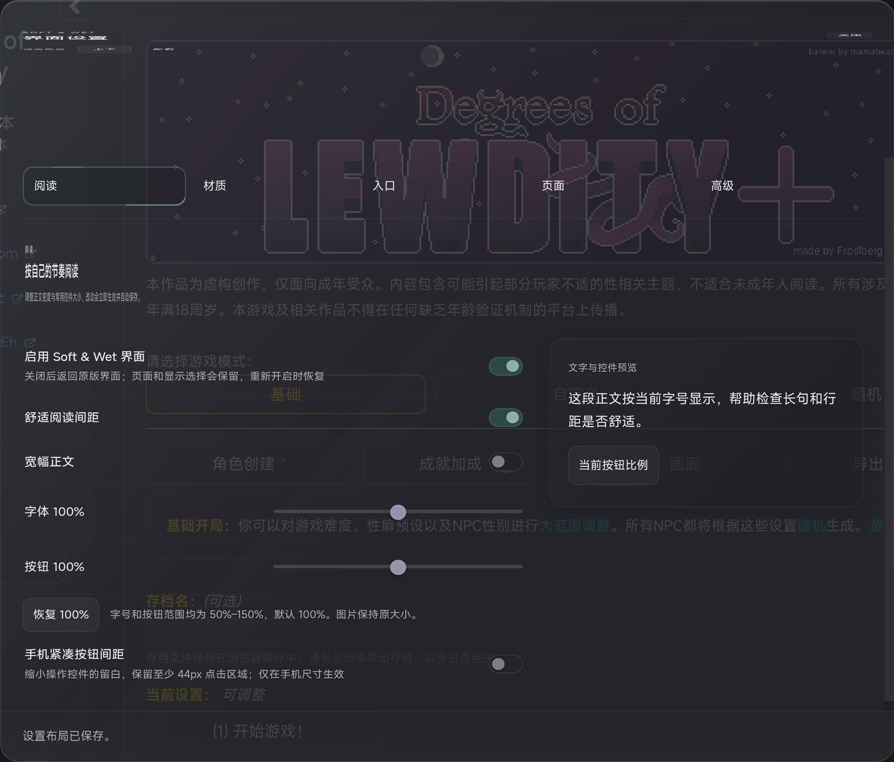

# Soft & Wet 4.0 — Evolution

[](https://github.com/102326/DoL-Game-UI/releases/latest) 

**快速流畅，华丽精致，感知舒服。**

Soft & Wet 为 Degrees of Lewdity 带来黑灰 Acrylic 界面，让游戏背景融入半透明玻璃，重新组织衣柜、服装店、角色信息与常用窗口。

Evolution 加入金属球回旋驱动的悬浮工具、新的玻璃天气与更连贯的设置转场，也修整了窗口在滚动、缩放和快速开合时的表现。购买、穿戴、战斗结算、角色数值和存档继续由原游戏及对应 Mod 处理。

[下载 4.0](https://github.com/102326/DoL-Game-UI/releases/tag/v4.0.0) · [安装与升级](#安装与升级) · [动态预览](#画面与动态预览) · [反馈问题](https://github.com/102326/DoL-Game-UI/issues)

> 普通玩家需要 **主 UI + Framework Host** 两个 ZIP。兼容包按已安装的 Mod 选用，所有安装包均无需解压。


*Android 测试版实机画面，采集于正式打包前；[素材来源与版本对应](docs/media/evolution-rain-header/provenance.json)。*

## 核心体验

### 回旋驱动的 Floating Hub

金属球体加速回旋，表面纹理、光照与残影带出工具菜单；关闭时，工具与背景一起收束。支持拖动、侧边停靠、快捷工具、键盘操作和快速反向。

新安装默认显示，已有隐藏偏好保留。可以在“界面设置”中关闭或找回入口，经典菜单仍可使用。

### 双布局设置与玻璃天气

“上下”使用横向分类，“左右”使用纵向分类。两种布局共用实际控件、偏好和实时预览，修改自动保存；长内容可以滚动，窗口打开时阻挡背后的游戏输入。

设置玻璃随 **DoL 游戏内天气** 呈现雨珠、雨丝、霜羽和环境光。血月的红色月面与云影、异世界的紫色流云、极热与严寒的雾光，也能与原有雨雪共同出现。雨中血月保留普通雨滴。

新的玻璃天气用于设置窗口，其它已适配窗口保留现有天气表现。关闭动画或启用减少动态效果时，使用静态表现；装饰层不接收点击。

### 衣柜与服装店

- **衣柜**：分类、搜索、当前穿搭、角色预览和参照比较；单击衣物仍直接穿戴，衣物详情与特质使用抽屉展示。
- **叠穿**：显示已识别的原版优化叠穿项目，保留作者的顺序调整和卸下操作。
- **服装店**：集中组织分类、配色、商品选择、报价和购买区域，用选中反馈与详情过渡帮助查看当前商品。

交易价格、试穿条件和穿戴规则沿用原游戏与对应 Mod。

### 角色信息与常用窗口

| 界面 | 主要体验 |
| --- | --- |
| 属性、社交与特质 | 协调的玻璃外壳、内容分组和导航焦点，保留原语义颜色与操作 |
| 成就、日志与统计 | 分类导航与正文阅读，焦点适应滚动和缩放 |
| 战斗 | 新安装默认开启动画、平铺全部选项；聚焦编辑可选，已有偏好保留 |
| 存档、导出／载入与已适配云存档 | 共用存档管理页头，保留原生业务与回退入口 |
| 游戏选项与作弊 | 原控件外观与响应式布局，生效规则由游戏或目标 Mod 负责 |
| 界面设置 | 字号、按钮大小、阅读宽度、间距、材质、动效及独立页面开关 |

本版修复窄屏战斗底栏偏移、关闭窗口后的背景残留，以及一条衣柜离场刷新路径；优化已适配窗口雨幕的持续重绘。存档操作会区分空槽与异常数据，无法确认时停止该次转发并保留原版入口，不自动改写存档。

## 画面与动态预览

| 预览 | 内容 |
| --- | --- |
| [Android 原速录屏 · 24 秒](docs/media/evolution-rain-header/android-settings-rain.mp4) | 设置双布局、分类、实际控件、开关与顶栏雨效 |
| [Floating Hub](docs/media/evolution-rc1-hub/desktop-1x.mp4) | 金属球回旋、真实工具展开与回收 |
| [设置与特殊天气](docs/media/evolution-special-integrated/desktop-1x.mp4) | 玻璃天气、特殊环境与窗口交互 |
| [窄屏设置](docs/media/evolution-special-integrated/narrow-1x.mp4) | 窄视口下的设置展示 |

<details>
<summary>更多实机画面：左右布局与血月</summary>




</details>

截图与第一段视频来自 Android 测试 App，其余视频为真实组件的受控原速演示。素材采集早于正式包，展示效果保留；不是正式 4.0.0 包的新录屏。来源与复用范围见[媒体记录](docs/media/evolution-rain-header/provenance.json)和[验证范围](docs/evolution/EVO-RELEASE-GATE-2026-10-24.md)。

## 安装与升级

| 项目 | 要求 |
| --- | --- |
| DoL | 当前适配与代表性验收基线为 **0.5.12.13** |
| ModLoader | **>=2.100.0**，本轮使用 2.101.1 |
| TweeReplacer | **>=1.0.0**，本轮使用 1.7.0 |
| Framework Host | **>=0.1.2-experimental 且 <0.2.0**；随本版提供 0.1.5-experimental |
| 平台 | Android 平板 WebView 与 Windows Edge 有代表性验证 |

最低要求与实测版本分别列出，不要求前置固定为本轮版本，也不保证所有未来版本或整合包均已验证。

1. 备份需要保留的存档，保存原包与加载顺序以便回退。
2. 停用旧的 `DoLGameUI`，每个技术身份只启用一个版本。
3. 从 [4.0 发布页](https://github.com/102326/DoL-Game-UI/releases/tag/v4.0.0)导入 **Framework Host** 和 **主 UI**，不要解压 ZIP。
4. Host 排在 UI 前；可选兼容包排在对应目标 Mod 和 UI 之后。
5. 重启游戏，检查版本、入口和设置，再载入自己的进度。

显示偏好保存在当前浏览器或 App 中，已有选择保留。`StoneFreeHost` 是 Framework Host 的技术包名。安装包不包含游戏本体、APK 或第三方主 Mod。详细步骤见[安装、升级与回退](docs/INSTALL_EVOLUTION_CANDIDATE.md)。

## 可选兼容包

| 包 | 作用与范围 |
| --- | --- |
| ModHubSoftWet | 管理器、市场、帮助中心及已识别工具浮层外观 |
| MapleBirchSoftWet | 云存档页面外观，保留原云端业务 |
| DolOptimizationSoftWet | 存档外观、异常日期的条件显示修复与原衣柜叠穿管理 |
| CheatExtendedSoftWet | 原作者 CE 及已支持独立维护版的外观 |
| ReOverfitsSoftWet | 额外服装槽位接入 |
| LyraMouthCompat051213 | 指定 Lyra 环境的嘴部资源适配 |
| SmartPhoneSoftWet | 万能手机 Alpha 及已识别组件外观 |

没有目标 Mod 就不安装相应兼容包。CE 原作者版与独立维护的 rebuild.30 只能启用一个；万能手机包不适用于 Omega。具体包版本、依赖与已验证范围统一见[发布页](https://github.com/102326/DoL-Game-UI/releases/tag/v4.0.0)。

原版优化日期修复仅在附加日期无效、且能确认存档时间时修改显示文字；正常日期保留，上游修复后自动让位，不改存档数据。

## 设置、兼容与回退

各专用界面可以独立关闭；关闭“启用 Soft & Wet 界面”可恢复原版显示。若设置也无法打开，可在 Loader 中停用 UI 并重启。

回退时停用当前 UI 及只适用于它的兼容包，恢复保留的原包和顺序，再重启。其它 Mod 仍依赖 Host 时保留 Host。不要清空存档或整个 App 数据。

当前已知限制：

- 部分 Android 环境在复杂天气下仍可能偶发慢帧，原因尚未确定。
- 未知第三方结构可能保留原外观；ModHub 全部安装／更新场景的卡顿与闪烁、历史衣柜同名异常仍不作根治承诺。
- 尚未穷举物理手机、iOS、WebView、衣物、商品、战斗及 Mod 组合；当前没有完整 FPS 或长期无泄漏结论。

更详细的覆盖范围和性能记录见[验证与已知限制](docs/evolution/EVO-RELEASE-GATE-2026-10-24.md)。

## Mod 作者与开发者

独立 Framework Host 提供公共 UI 能力，官方 UI API 保持 v1，Host 公共协议仍为实验性协议。维护中的自有代码和工具已按 TS First 整理，CommonJS 运行形式按需保留；玩家不需要安装 Node。

- [UI Runtime API](docs/UI_RUNTIME.md)与[接入示例](examples/ui-surfaces/README.md)
- [持续集成](docs/CI.md)、[兼容适配](docs/OPTIONAL_ADAPTERS.md)、[发布说明](docs/RELEASE_4.0.0.md)
- [发行校验清单](docs/releases/4.0.0/SHA256SUMS.txt)

<details>
<summary>源码检查与构建</summary>

开发工具采用 **Node.js >=26.12.1 且 <27**，另需 npm 和 Python；CI 使用 Python 3.12。

```text
npm ci
npm run ci:check
npm run ci:build
```

主 UI 与 Host 输出到 `dist/framework/`，七个兼容包输出到各自的 `compat/*/dist/`。包合同、反例与双构建校验使用 `npm run ci:packages`。不同系统的压缩容器摘要可能不同，重新构建的文件不能直接替换公开附件。

</details>

## 反馈与许可

通过 [GitHub Issues](https://github.com/102326/DoL-Game-UI/issues)提供游戏、Loader、UI／Host 和相关 Mod 版本、设备、复现步骤及实际表现。截图、日志与存档可选；公开反馈前请检查是否含账号凭据、敏感数据或无权分发的内容。

项目原创代码使用 [MIT](LICENSE)，版权署名为 DoLWorkbench contributors。衣柜衍生渲染及四项游戏 Twee 替换来自 Vrelnir 及 Degrees of Lewdity 贡献者，适用 **CC BY-NC-SA 4.0**；见[来源与修改说明](UPSTREAM-RENDERER-NOTICE.md)和[完整许可](UPSTREAM-RENDERER-LICENSE)。MIT 不替代这些代码的原许可。Vue、Tailwind CSS、GSAP 等依赖的声明随包保留。
