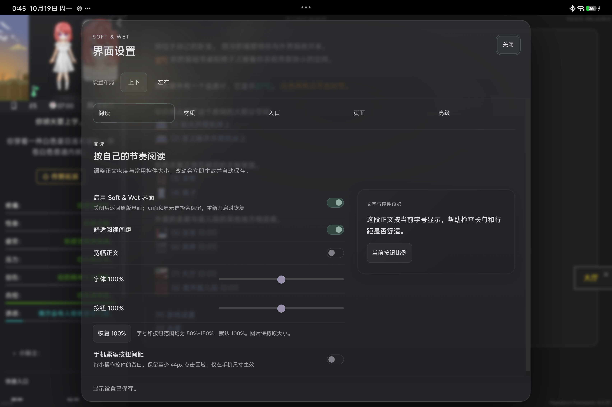
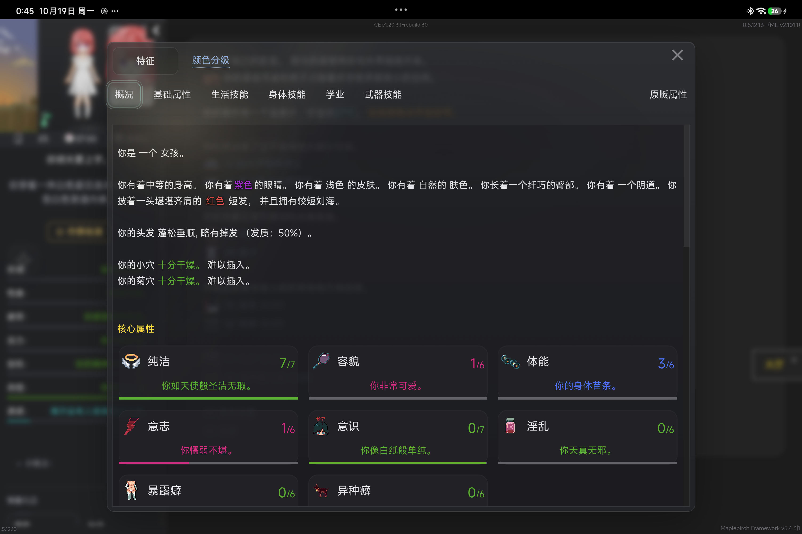
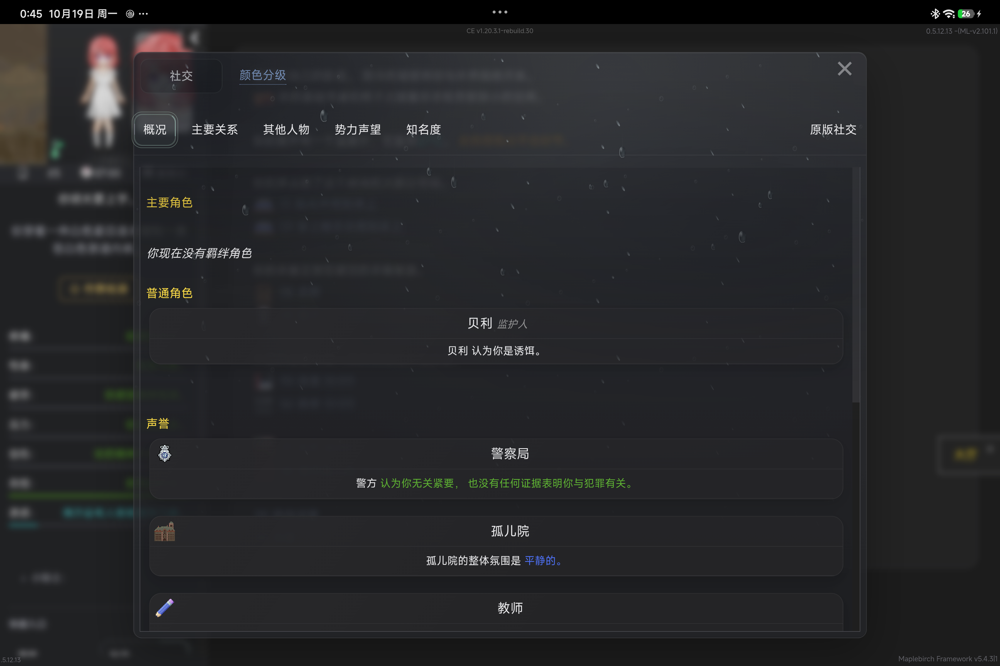
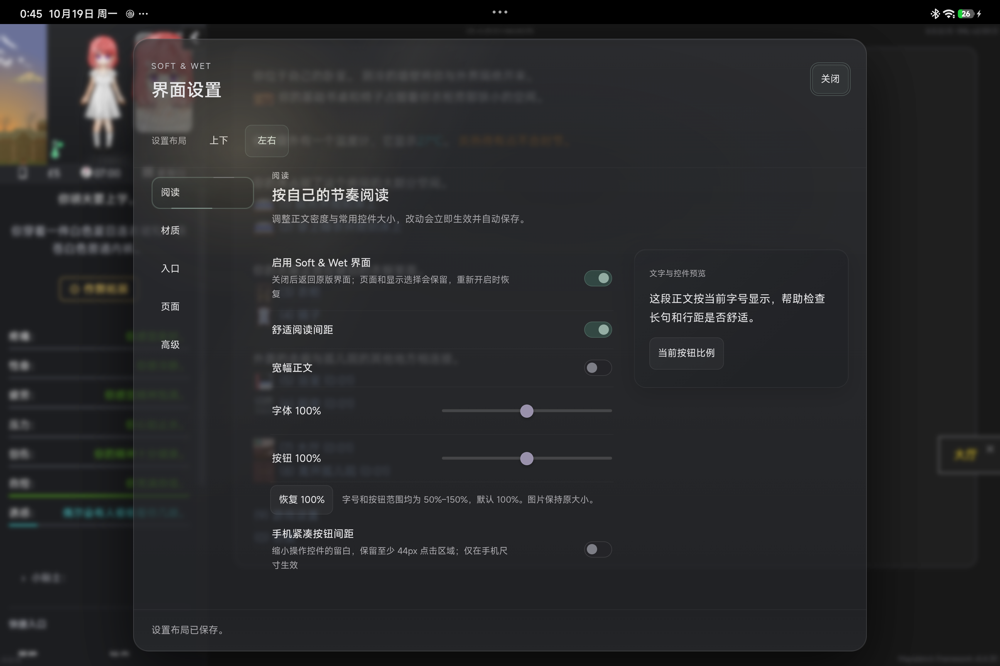
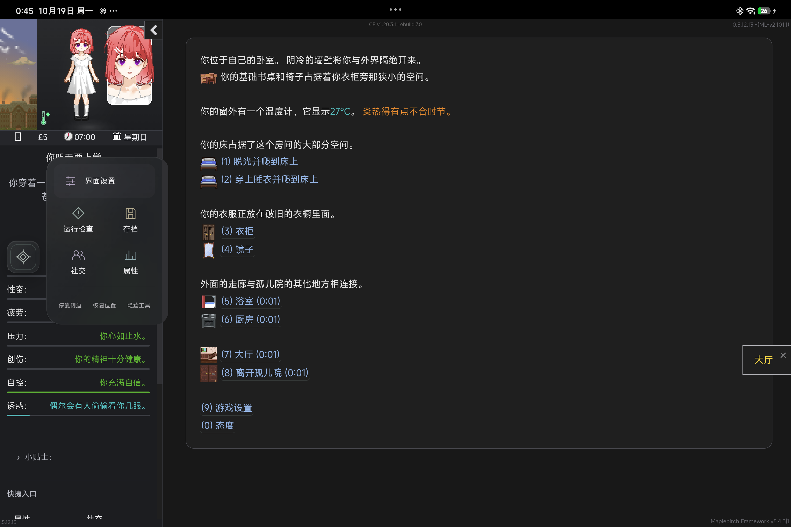
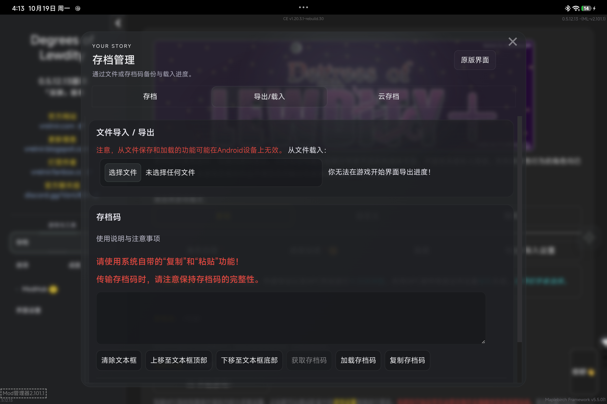

# Soft & Wet 3.0.3 — Kraft Work

[](https://github.com/102326/DoL-Game-UI/releases/latest)


**Soft & Wet UI** 为 Degrees of Lewdity 提供黑灰 Acrylic 界面，重新组织衣柜、服装店、角色信息和常用窗口。半透明材质让游戏背景自然参与画面，导航焦点、按钮反馈与空间转场让操作更连贯。

Kraft Work 加入游戏天气响应、设置双布局与可选 Floating Hub。购买、穿戴、角色数值和存档仍由原游戏及对应 Mod 处理。当前版本包含 ModHub 管理器／帮助中心、存档三页与默认兼容外观；3.0.3 修复衣柜叠穿时穿戴波纹相对衣物列表错位，适应区域增高、滚动与缩放。所有现行 UI 设计统一采用 3.X，1.X／2.X 设计封存，不再使用。

[下载 3.0.3](https://github.com/102326/DoL-Game-UI/releases/tag/v3.0.3) · [安装步骤](#安装与升级) · [完整更新说明](docs/RELEASE_3.0.3.md) · [反馈问题](https://github.com/102326/DoL-Game-UI/issues)

普通玩家需要 **主 UI + Framework Host 两个 ZIP**，使用相应第三方 Mod 时再选装兼容包。**不要解压**，导入后重启游戏。安装包不包含游戏本体、APK 或第三方原 Mod。



以上为正式运行包在 Android 测试环境中的真实画面。视口、背景、偏好与 Mod 组合会影响实际效果。

## 核心界面

### 衣柜

- 按分类或跨已支持分类搜索，查看衣物状态、已穿戴标记与保暖情况。
- 点选衣物仍直接穿戴，保留原穿戴限制和已验证的第三方叠穿行为。
- 查看当前完整穿搭，暂存参照并比较；“衣物详情与特质”使用独立抽屉。
- 整理模式保留原有丢弃、套装处理、修理与转移入口，具体操作依原游戏条件执行。

### 服装店

- 分类、搜索、配色与购买区域集中组织，可保存进店默认服装类型。
- 商品选中波纹、详情过渡与信息比较帮助查看当前选择；窄屏使用详情抽屉。
- 保留原报价、购买与试穿路径，视觉展示不改写交易规则。

### 角色信息与常用窗口

属性、社交、特质、成就、日志和统计等已适配窗口使用协调的 Acrylic 外壳、导航与内容层次。保留原游戏的语义颜色，以及原有按钮、链接与表单操作。

<details>
<summary>查看角色信息画面</summary>



</details>

### 战斗

默认开启战斗界面与动画，原生动作控件**全部展开、平铺显示**，保留原动作、判定与结算。聚焦编辑仍为可选模式；模式选择会保存，聚焦时也能上下滚动。已有关闭偏好继续生效。

## 材质、天气与交互

黑色与深灰色为主体，半透明、柔和模糊与分层材质共同承载内容。窗口展开与退场、动态导航焦点、按钮按压和不同场景的过渡使用适合各自用途的动画。材质与动画可以关闭，系统减少动态效果时自动退化。

窗口响应 **DoL 游戏内部天气**，无需现实天气服务：晴天暖光、多云明暗漂移、雨天细雨与玻璃水珠、雷雨局部照明，以及雾、雪的环境表现。雨量影响动态节奏，装饰层不接收点击。



[观看 Android 原速天气视频（约 12 秒）](docs/media/3.0.0/KraftWork-3.0-weather-android.mp4)。演示通过游戏原有天气接口准备雷雨，不代表帧率性能测量。

## 设置双布局与 Floating Hub

设置支持**上下布局**和**左右布局**，共享同一套真实控件、偏好与预览；修改后自动保存。打开设置时阻挡背后游戏输入，长内容可以滚动。

Floating Hub 提供可选悬浮快捷入口，支持展开、收起、拖动、侧边停靠和已支持窗口的工具交接。**新安装默认显示**，在“界面设置 → 入口 → 高级快捷工具”可调整或关闭。已有隐藏偏好保留。点击展开，拖动移动，也可使用键盘方向键调整。

<details>
<summary>查看左右设置布局与 Floating Hub</summary>





</details>

## 其它界面与功能

| 界面 | 主要内容 |
| --- | --- |
| 存档管理 | 存档、导出／载入与已适配云存档共用页头；列表、详情及底部操作可滚动触达 |
| 游戏选项与作弊 | 原生控件外观和响应式布局，生效规则由游戏或目标 Mod 负责 |
| 阅读与界面设置 | 字号、按钮大小、阅读宽度、间距、材质、动效与独立页面开关 |
| 进阶选项 | 衣柜分页和按需启用的兼容／性能实验；不以减少 DOM 工作量代替整体性能承诺 |

本版不包含 Widget、自由布局编辑器或全局动作底栏。



## 安装与升级

| 项目 | 要求 |
| --- | --- |
| DoL | 当前适配与主要验收版本为 **0.5.12.13** |
| ModLoader | **>=2.100.0**，实测 2.101.1 |
| TweeReplacer | **>=1.0.0** |
| Framework Host | **>=0.1.2-experimental 且 <0.2.0**；推荐并实测 **0.1.4-experimental** |

最低要求、推荐版本与实测组合分别说明；满足最低要求不代表所有后续版本或整合包均已验证。Host 的公共协议仍为实验性协议。

1. 备份存档，保留原 UI 和对应兼容包以便回退。
2. 停用原 `DoLGameUI`，每个技术身份只启用一个版本。
3. 从 [最新 Release](https://github.com/102326/DoL-Game-UI/releases/latest) 下载并导入 `StoneFreeHost-0.1.4-experimental.mod.zip` 与 `DoLGameUI-3.0.3.mod.zip`，不要解压。
4. Host 排在 UI 前。可选兼容包排在对应目标 Mod 和 UI 之后；没有目标 Mod 就不安装相应兼容包。
5. 重启游戏，检查界面与版本，再载入自己的进度。显示偏好保存在当前浏览器或应用中，与游戏存档分离。

`StoneFreeHost` 是 Framework Host 保留的技术包名；对外版本代号为 **Kraft Work**。开发样例、Factory 和 Author Kit 不是玩家必装项。详细说明见 [安装与回退](docs/INSTALL_3.0.3.md)。

## 可选兼容包

| 包 | 作用与范围 |
| --- | --- |
| ModHubSoftWet | ModHub 管理器外观 |
| MapleBirchSoftWet | MapleBirch 云存档页面外观，不接管云端业务 |
| DolOptimizationSoftWet | 原版优化的存档外观与衣柜叠穿管理，保留原描述编辑、槽位和叠穿操作 |
| CheatExtendedSoftWet | Cheat Extended 外观，适配原作者版及已支持的独立维护版 |
| ReOverfitsSoftWet | ReOverfits 额外服装槽位接入 |
| LyraMouthCompat051213 | 指定 Lyra 环境的嘴部资源适配 |

按自己安装的 Mod 选用相应兼容包；Cheat Extended 的不同发行版不要同时启用。具体版本、依赖要求、安装顺序和已验证范围以[最新发布页](https://github.com/102326/DoL-Game-UI/releases/latest)为准，后续更新统一在那里说明。

## 设置、兼容与回退

各专用界面可独立关闭；关闭“启用 Soft & Wet 界面”可恢复原版显示。衣柜操作进行时应先等待操作结束。若设置也无法打开，可在 Loader 中停用 UI 并重启。

需要回退时，停用当前 UI 与只适用于当前 UI 的兼容包，恢复保留的原包后重启。其它 Mod 仍使用 Host 时应保留 Host。不要清空整个游戏数据，不依赖整包热卸载。

## Mod 作者与开发者

技术栈为 Vue 3、TypeScript、Vite 与 Tailwind CSS。独立 Framework Host 提供公共 UI 能力，作者可只安装 Host，不依赖官方 UI；公共协议当前为 `0.1-experimental`，官方 UI API 为 v1。

- [UI Runtime API](docs/UI_RUNTIME.md) 与 [接入示例](examples/ui-surfaces/README.md)
- [持续集成：检查范围与本地运行](docs/CI.md)
- [基础设施与所有权边界](docs/UI_INFRASTRUCTURE.md)、[独立 Adapter](docs/OPTIONAL_ADAPTERS.md)
- [发行验证记录](docs/KRAFT_WORK_3.0.3_VALIDATION.md)、[下载校验清单](docs/releases/3.0.3/SHA256SUMS.txt)

<details>
<summary>3.0 源码构建</summary>

需要 Node.js 22.12+、npm 和 Python 3.10+。以下为 Framework／官方 UI 双包入口：

```text
npm ci
npm run typecheck
npm run framework:check
node scripts/build-framework.mjs
python scripts/package-framework.py --players-only
```

构建结果位于 `dist/framework/`。仓库另有经典构建入口，不应替代上述 3.0 构建。公开 Host 使用冻结原包；重新构建的文档或 ZIP 元数据可能不同，应核对运行成员，不自动覆盖公开附件。

</details>

## 反馈

通过 [GitHub Issues](https://github.com/102326/DoL-Game-UI/issues) 提供 DoL／Lyra、Loader、Host／UI、相关 Mod 版本，以及设备、浏览器或 WebView、复现步骤、实际和期望表现。适用时附日志片段或截图；截图、日志和存档均可选；可主动提供并明确授权使用有助于复现的存档，公开 Issue 附件可能被他人访问。开发侧在源码树外隔离复现，不自动纳入公开 CI Artifact；不要提交账号凭据、敏感数据或未获授权分发的 Mod 包。

## 许可与来源

项目原创代码使用 [MIT](LICENSE)。衣柜衍生渲染及四项游戏 Twee 替换适用 **CC BY-NC-SA 4.0**，见 [来源与修改说明](UPSTREAM-RENDERER-NOTICE.md) 和 [完整许可](UPSTREAM-RENDERER-LICENSE)。MIT 不替代这些代码的原许可；第三方依赖声明随运行包保留。展示截图与录像的来源见 [素材说明](docs/media/3.0.0/README.md)。
