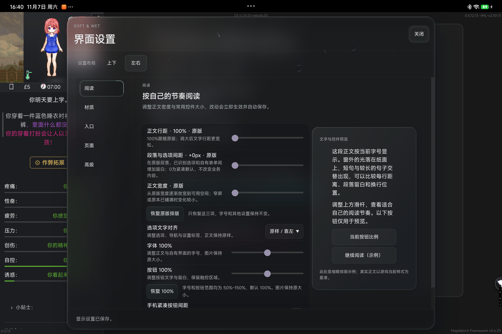

# Soft & Wet 5.0 — Stone Free

Soft & Wet 为 DoL 的侧栏、设置、商店、衣柜和常用窗口提供可调整的玻璃界面。5.0 默认使用静水暗玻，提供石墨灰、青灰和自定义配色。你可以预览配色与字体、调整玻璃通透度，也可以随时切回原来的界面。

[5.0 更新内容](docs/RELEASE_5.0.0.md) · [5.0 候选安装与回退](docs/INSTALL_5.0.md) · [下载正式稳定版](https://github.com/102326/DoL-Game-UI/releases/latest)

## 5.0 里能看到什么

- **颜色与字体。** 从侧栏进入「界面设置」，选一种配色，或导入本地 TTF。预览合适后再保存。
- **设置与天气。** 设置窗口在收起途中可以重新打开；雨雪变化时，玻璃上的天气接着当前进度播放。关闭玻璃后用实色区分内容层次。
- **悬浮工具。** 双菱形表冠可拖动，停靠后半收在左边或右边。轻点即可恢复，展开时可选列表或弧形抽屉。
- **服装店。** 平板和电脑在右侧看款式、配色和价格，手机从底部打开详情。中文选词后可以继续输入；关掉详情可回到刚才选的商品。

## 安装与升级

玩家需要 Framework Host 和主 UI 两个 ZIP。5.0 候选使用 `StoneFreeHost-1.0.0-rc.1.mod.zip` 和 `DoLGameUI-5.0.0.mod.zip`。导入 Loader，让 Host 排在主 UI 前并重启。从 4.5.2 升级时两个都换，先留好原包和顺序。适配基线为 DoL 0.5.12.13、ModLoader 2.100.0+ 和 TweeReplacer 1.0.0+。

按自己安装的内容选用 ModHub、MapleBirch、原版优化、Cheat Extended、ReOverfits 或指定 Lyra 的适配包。包名、安装顺序与回退步骤见[安装指南](docs/INSTALL_5.0.md)。

## 预览和项目资料

[历史动态预览](https://raw.githubusercontent.com/102326/DoL-Game-UI/v4.2.0/assets/releases/4.2/soft-wet-4.2-windows.mp4) · [架构与接入](docs/UI_RUNTIME.md) · [构建与 CI](docs/CI.md) · [开发交接](docs/HANDOFF.md) · [问题反馈](https://github.com/102326/DoL-Game-UI/issues)

原创代码采用 [MIT 许可证](LICENSE)。派生部分的来源与许可见 [UPSTREAM-RENDERER-NOTICE.md](UPSTREAM-RENDERER-NOTICE.md) 和 [ModHub 声明](MODHUB-PERFORMANCE-NOTICE.txt)；发行包内另附第三方依赖声明。
