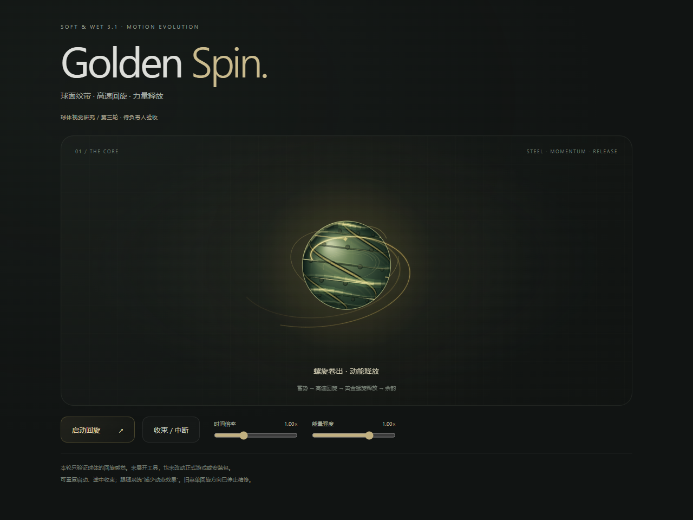

# Golden Spin B · 球体视觉研究

2026-10-21。[Issue #22](https://github.com/102326/DoL-Game-UI/issues/22)，分支 `prototype/golden-spin-b`。稳定基线 `6a6e3c00b705dc67d37c1780b27f585847da5d1a`，未修改公开安装包、Tag 或 Release。

## 当前决定

负责人已否决以工具菜单螺旋运动为主体的旧样片。新的核心是球体本身获得回旋动能，再驱动工具；旧菜单运动停止精修，[技术成果与失败边界单独归档](MOTION_EVOLUTION_MENU_STUDY_ARCHIVE.md)。

当前只交付 **Prototype A：回旋之力本体**。这里 A 是实验阶段名，正式产品目标仍是 Golden Spin B。负责人认可球体后，才进入 Prototype B 的真实菜单展开与回收整合。

- [修改前后对照](media/golden-spin-b/gs03-before-after.mp4)：左侧为本轮前的自制样片，右侧为本轮修改后；两侧均为原速，各自播放一次，不调整速度来对齐阶段。
- [当前桌面动态样片](media/golden-spin-b/sphere-gs03-desktop.mp4)
- [当前窄屏动态样片](media/golden-spin-b/sphere-gs03-narrow.mp4)
- [运行方法](../prototypes/golden-spin-b/README.md)

视频均来自本分支独立网页，不是游戏录像，也没有展示已整合的正式 Hub。

## 这次实现了什么

第三轮强化球体自身的运动：Canvas 2D 绘制球面投影纹带，亮部随转角横向掠过表面，背面的部分隐藏；加入错位短残影和不对称纹理标记。高速时降低静态网格与嵌点的存在感，保留实体轮廓。球体定位保持稳定，不通过转动整个界面制造运动。

启动前 0.16 秒即提起转速，随后继续蓄势；默认一次约 4.17 秒：1.11 秒蓄势、0.96 秒释放、2.1 秒减速。外围改为两道贴近球面的切向流线，按半径衰减并向外卷出，与球面共用关联角速度；取消完整闭合圈，降低大范围泛光。释放后余韵逐步消失，途中可以收束或重新蓄势，保留当前角度与状态，不硬切回起点。

页面提供时间倍率、能量强度研究控件。当前没有工具菜单、第二份游戏状态或业务事件代理。系统减少动态效果时显示静态能量形态；闲置不持续绘制，隐藏页暂停，卸载清理时间线、帧回调、尺寸和媒体监听。

## 技术选择

复用已引入的 **GSAP 3.15.0** 编排多段状态与中断，Canvas 2D 负责球面与能量绘制，没有增加新的图形库。GSAP 的收益是直接编排多字段蓄势、释放、收束，减少手写时间管理；原生 RAF / WAAPI 同样能够实现，尚无证据说明必须进入生产依赖。

当前独立网页构建 JS 约 139 KB（gzip 约 55 KB），包含 Vue、GSAP 和研究界面；精确值看构建日志。不是正式 UI 的净增包体。Canvas 使用主线程并限制 DPR≤2；尚未获得真实设备帧率或长期功耗结论，不能据此宣布性能通过。

GSAP 是专有 [Standard No Charge License](https://gsap.com/standard-license/)，不是项目 MIT。构建保留版权横幅、项目 LICENSE 与[第三方声明](../prototypes/golden-spin-b/THIRD_PARTY_NOTICES.md)。球体与轨迹均由程序绘制，没有嵌入第三方画面。

## 验证与边界

当前 Edge 受控页面检查覆盖：加速→释放→余韵、释放前球体内部像素实际变化、快速重启与收束的角度连续性、390px 窄屏模拟触控、尺寸变化、键盘、播放中开启减少动态效果，以及卸载后回调停止。类型检查与独立构建通过；未改动的 UI / Framework 合同检查复用此前有效结果。CI 状态以实际 GitHub Run 为准。

首轮录屏回看发现绘制可能停在首帧：初次 RAF 早于 GSAP 首次 tick，误用 `isActive()` 使绘制循环提前退出，而阶段文字仍继续变化。已改为由时间线存续决定绘制循环，新增实际绘制次数与角度变化检查；失效录像保留本地，不作为当前交付。最终视频重新取景。

前两次 GitHub Run 的减少动态效果检查失败，保留原 Run。先发现静态偏好重绘与计数采样相交；仅等待通知后仍出现超时。补充失败状态后确认：浏览器已经返回 `matches=true`，但通知计数仍为 0，页面可见且实例存活。通知未送达的浏览器内部原因仍为 Unknown，不再把第一次测试同步修正说成已经解决。

原型现同时在播放请求和活动帧读取实际偏好，通知缺席时也立即取消时间线并静态展示。验证改为播放中开启减少动态效果，检查角度停止、没有活动帧；只允许实际偏好通知引起的一次静态重绘，不把它误算成持续动画。另修复研究状态误带 GSAP 循环缓存、导致失败 JSON 无法写入的问题。

旧菜单研究的 Android 临时接入结果不属于新球体样片的设备验证。新阶段尚未接入真实 Hub，也未进行 Android / iOS 物理触控、长期资源或低端设备性能验收。此前通用工程保留在隔离分支，正式入口不启用实验 hook。

| 状态 | 当前结果 |
| --- | --- |
| Delivered | 球体优先的可交互 Prototype A、桌面与窄屏视频 |
| Validated | 当前受控浏览器交互、类型 / 合同、构建 |
| Owner Acceptance | Pending，必须由负责人判断回旋视觉方向 |
| Next | 认可球体后再做回旋驱动真实菜单 |
| Release Authorization | 无；不合并 main，不创建 Tag 或发布 |

长期全 UI 动效演进授权仍有效，但不因此启动全 UI 重写或扩大本轮交付。
