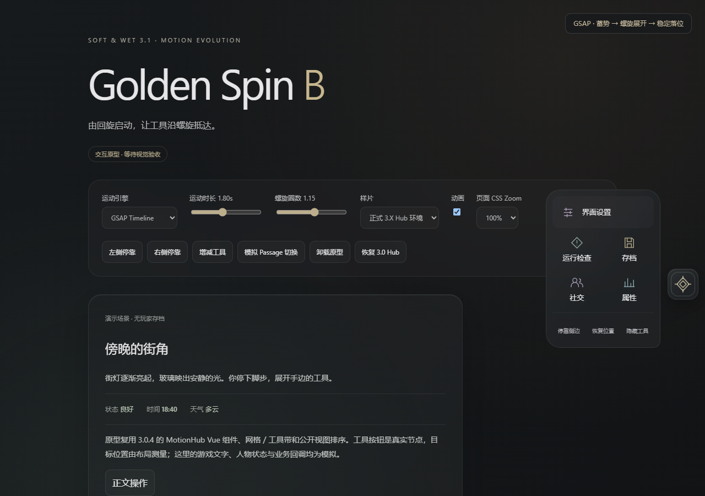

# Golden Spin B 菜单运动研究归档 · 视觉方向未通过

**历史研究，已被负责人纠偏取代。** 2026-10-21 负责人否决以工具多圈螺旋为主体的表现；本记录只保留可复用工程和当时证据。不得用下文技术通过替代视觉验收。当前入口为[球体视觉研究](MOTION_EVOLUTION_GOLDEN_SPIN_B.md)。

2026-10-21。跟踪 [Issue #22](https://github.com/102326/DoL-Game-UI/issues/22)，分支 `prototype/golden-spin-b`。基线为稳定线 main `6a6e3c00b705dc67d37c1780b27f585847da5d1a`：UI 3.0.4、Host 0.1.5-experimental，包含已公开的 ModHub 兼容维护。原型没有修改公开 Release 或 Tag。

## 当前交付

已实现可操作的真实 Hub 原型，保留正式 MotionHub Vue 组件、网格／工具带、真实按钮和默认排序。球体整体蓄势与旋转，工具按相位错开的螺旋抵达原布局，带短暂倾斜纵深与动态材质；关闭时沿运动关系回收。没有使用按钮克隆代替真实工具。

提供 GSAP / WAAPI 对照、时长及圈数调整、左右侧、动态工具、CSS Zoom、卸载重挂与恢复原 Hub 的研究入口。[运行方法与视频](../prototypes/golden-spin-b/README.md)。

此图为受控浏览器，文字、游戏状态和工具业务回调均模拟。不是正式 3.1 或完整游戏验收。

## 授权及范围

- SW31-GS-01：Golden Spin B 为唯一视觉目标，不降级为方案 A。
- SW31-GS-02：允许隔离分支修改真实 Hub 的实验动画层、使用成熟框架和空间／惯性／材质探索，须可关闭恢复。
- SW31-MOTION-02：长期允许全 UI 动效修改、重构或重做；共享能力，不机械统一视觉动作。当前仍以 B 为首要交付，不自动扩大 3.1、不自动延期 3.5、不启动全 UI 重写。
- 委托转述的小鸥评审为 Accept with Changes。本轮采用委托列出的要求，不推定未提供的评审全文内容。

保留 Host + UI、游戏业务、存档语义和兼容合同。不修改 Host API，不覆盖正式制品，不合并 main，不建立自动发布。

## 实际运动模型

`path.ts` 在物理视口中计算位置：目标中心由真实布局测量，中心沿起点到目标迁移，叠加收放半径的椭圆螺旋；工具相位依排序错开。半径受可用空间约束，目标不使用硬编码坐标。端点位置与缩放收敛到原布局，结束后清除工具 transform，归还布局控制。

球体的原生定位 transform 仍由 Vue 写入；最终研究源码使用 CSS 变量驱动本地伪元素外壳和图标旋转，避免独立 rotate 影响定位 translate。真实工具的 transform 仅由原型控制，原 CSS 过渡在 opt-in 标记内撤销。

GSAP Timeline 或 WAAPI timing effect 仅拥有单一时间进度，统一渲染函数写入工具。重新定向采用带当前带符号速度的 Hermite 时间曲线，先制动再反向。布局变化重新测量，并以衰减位置补偿避免跳位；这条重测路径保证位置衔接，不宣称任意几何重排都保持速度一阶连续。

现有组件增加 opt-in `experimentalMotion` hook，只有原型传入。hook 内按 layer 物理尺寸／布局尺寸换算 CSS Zoom 下的布局和指针位移；正式入口未传入，旧路径保留。原生按钮业务和 Host 公共协议不改变。

## GSAP 与 WAAPI 的实际对照

采用 GSAP **3.15.0**，锁定为 devDependency，仅原型导入。它提供 Timeline 的进度、标签、更新和取消管理；本轮并未使用付费插件、Flip、MotionPath 或通用动画框架。

两种引擎使用相同模型与 DOM 写入。WAAPI 使用无目标 timing effect，通过 currentTime 驱动同一渲染；它不是一个已经做完合成线程优化的原生关键帧方案。因此不能用本轮结果认定 WAAPI 的性能上限。

| 项目 | GSAP Timeline | WAAPI 时钟 |
| --- | --- | --- |
| 完整 B 路径与反向 | 通过同一模型实现 | 通过同一模型实现 |
| 时序管理 | Timeline、标签、onUpdate、kill | Animation、RAF 采样、finish／cancel |
| 轨迹与惯性 | 仍需自定义函数 | 仍需同一自定义函数 |
| 时钟入口独立压缩构建 | 70,805 bytes；gzip 27,959 | 456 bytes；gzip 288 |
| 生产选型 | 保留研究，不因使用 Timeline 就宣布必要 | 可达到本轮同等运动，复杂编排收益还需继续比较 |

同时含两个引擎的真实游戏临时开发包为 79,554 bytes JS、2,794 bytes CSS；该包是研究工具，含可关闭面板，不是给正式 UI 净增体积的承诺。正式采用时仍须剔除对照、工具面板和开发入口后测量。

一次 Edge 受控采样中，四次开关约 2.83 秒：GSAP TaskDuration 0.572 秒／15 次布局，WAAPI 0.621 秒／14 次布局。它们的实际回调次数不同，样本不是严格性能基准，没有据此宣布显著胜出或 FPS 结果。

当前结论：运动品质主要来自轨迹、布局接缝和重定向模型。GSAP 可简化时间线操作，但单一进度场景尚不足以证明必须进入生产依赖；也不据此否定成熟框架在后续复杂场景的收益。

## 实际验证

Windows Edge 受控浏览器已覆盖：真实节点保留、一次工具回调、运动中反向、连续开关、两个引擎、左右侧、1280×900 / 390×844 / 844×390、80% / 100% / 125% CSS Zoom 的双侧落位及命中、动态工具增减、运动中 resize／拖动、模拟场景失效、Escape／焦点、reduced motion／动画关闭、卸载／外部移除／重挂、恢复原 Hub。

本地命令通过：`prototype:golden-spin:check`、`prototype:golden-spin:build`、`prototype:golden-spin:test`、`ci:check`。GitHub CI 的实际结果以 Issue 对应 Run 为准，不以本地成功代替。

真实 Android WebView 在授权独立 DoL 测试 App 的 Start 页临时接入开发包：实际 UI 3.0.4、Host 0.1.5-experimental、协议 0.1-experimental、CSS Zoom 100%。五个原工具的落位命中检查通过，录制完整展开／关闭、快速反向和左侧展开，关闭原型后核对样式标记、位置偏好及原状态恢复。

这是临时开发接入，不是原型 ModLoader 安装；点击和键盘事件由程序控制，不是物理触控。未调用真实业务工具、未切换真实 Passage、未写入游戏存档。原始 Android 录像与设备身份留在本地；公开视频是独立受控样片。

## 发现并处理的问题

- 首版旧菜单缩放／裁切仍覆盖原型样式，导致工具被二次缩小。已撤销 opt-in 范围内的冲突，并以最终画面复查。
- 原组件 125% Zoom 右侧会超出视口。实验 hook 采用同一坐标空间换算，新增双侧实际命中检查；稳定版原代码路径未被静默替换。
- 反向请求清零速度到首帧之间出现短暂状态不连续。已在等待新时钟首帧期间保留原速度，原反向检查继续通过。未删除失败断言。
- 环境最初缺少 Playwright 录屏依赖；补装对应官方 FFmpeg 后生成样片。失败不记为产品已通过。

## 尚待收敛

拖动开始时选择安全收起工具，不保留飞行中的整套拖拽惯性；工具数量超出代表范围、任意重排和任意变换祖先未完整覆盖。低端设备、iOS、真实软键盘、长时间运行及全部社区组合未验证。该研究依赖 WAAPI、Pointer Events、ResizeObserver 等宿主能力，不声明新的浏览器最低版本政策。

GSAP 采用其专有 [Standard No Charge License](https://gsap.com/standard-license/)，不是项目 MIT 许可；原型保留版权横幅与[独立依赖说明](../prototypes/golden-spin-b/THIRD_PARTY_NOTICES.md)。该许可限制竞争性可视化动画编辑工具，不应把本 UI 原型的适用性自动扩大到未来可视化编辑器。

**菜单视觉方向已被否决，停止精修。** 工程检查可作为布局、取消和生命周期的研究依据。Android 录像及本页旧媒体早于最终的球体局部变换、重定向首帧修复，不证明这些后续修复已在 Android 复验。新球体样片另行记录，不继承旧视觉或设备验收结论。
