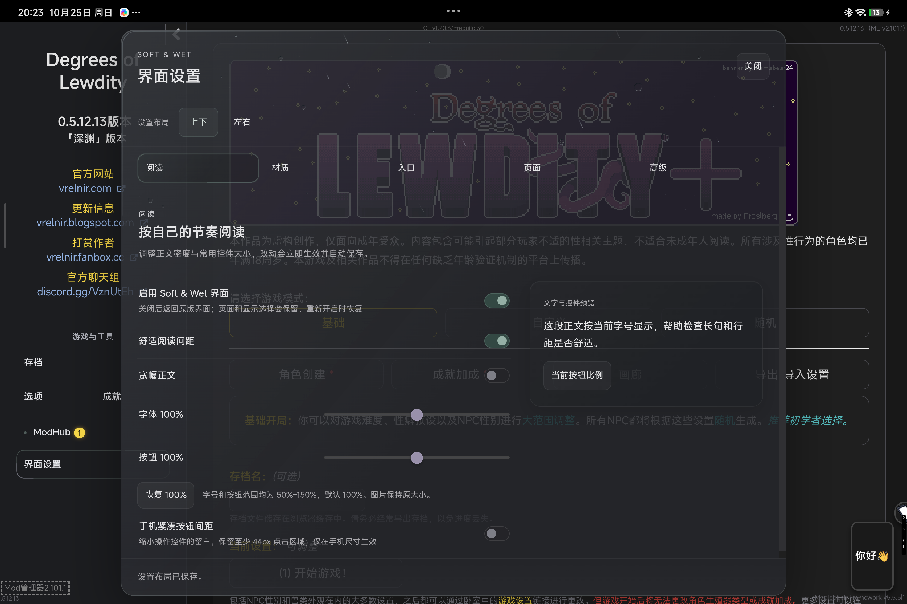

# Soft & Wet 4.0 — Evolution

> 顶部雨效修复 `1c0cade` 已进入复验，原尺寸、流速和折射保留，F1仍Open，尚未封正式发布包。当前进度与原速录屏见[顶部雨效报告](evolution/EVO-RAIN-HEADER-PERF-2026-10-25.md)；当前九包与摘要见[评审输入清单](evolution/EVO-RAIN-HEADER-PACKAGES-2026-10-25.json)，仅供验收。

> 当前候选存在[Android暴雨设置性能阻塞](evolution/EVO-ANDROID-GLASS-PERF-F1-2026-10-25.md)，尚未满足发布封包条件。

> 首页替换稿，尚未启用。更新2026-10-25，对应已完成TS First及存档P2独立复核的内部候选4.0.0-rc.2（受验代码1c0cade），拟正式4.0.0；正式发布与下载入口待负责人最终确认。

Soft & Wet 为 Degrees of Lewdity 提供黑灰 Acrylic 界面，整理衣柜、服装店、角色信息和常用窗口。Evolution 延续3.X视觉基线，更新悬浮工具与设置的动态表现，并改进窗口在滚动、缩放和快速切换时的行为。

购买、穿戴、战斗结算、角色数值和存档继续由原游戏及对应Mod处理。安装包不包含游戏本体、APK或第三方主Mod。

## 核心界面

### Floating Hub

金属球体通过回旋纹理、光照和残影带出真实工具菜单。点击后球体立即响应，菜单留出蓄势时间再展开；关闭时工具与背景一起收束。

保留拖动、侧边停靠、工具调用、键盘和快速反向。新安装默认显示，已有隐藏偏好保留；可在界面设置中关闭，经典入口继续作为回退路径。

### 设置与天气

设置支持上下、左右两种布局，共用真实控件、偏好与实时预览。开关采用短过渡，分类切换保留连续动态；修改自动保存，长内容可滚动，窗口打开时阻挡背后的游戏输入。

设置玻璃响应游戏内降雨、降雪及血月、异世界、极热和严寒，呈现水珠、雨丝、霜羽、月面云影与环境雾光。雨中血月使用普通雨滴。其它已适配窗口保留各自现有天气表现，修复共享雨幕在ModHub等窗口中的持续重绘卡顿。天气来自DoL，不调用现实天气服务；装饰层不接收点击，关闭动画或减少动态时采用静态表现。

### 角色信息与常用窗口

属性、社交、特质、成就、日志和统计等已匹配窗口使用协调的外壳、导航与内容层次。保留原语义颜色、链接和表单操作，导航焦点适应滚动与缩放。

### 衣柜与服装店

- 衣柜支持分类、搜索、当前穿搭、预览、参照比较和衣物详情抽屉；点选衣物仍执行原穿戴操作。
- 已识别的原版优化叠穿项目可以显示多件，保留原顺序调整和卸下入口。
- 商店集中展示分类、配色、商品选择、报价和购买区域，保留原购买、试穿与退出路径。
- 动态选择反馈和详情过渡帮助辨识当前物品，不改写交易或穿戴规则。

### 战斗与存档

新安装默认开启动画、平铺全部战斗选项；聚焦编辑可选，已有偏好保留。修复缩放后的战斗底栏偏移及一条衣柜离开时的失效刷新路径。

存档、导出／载入与已适配云存档共用管理页头。原版优化附加日期无效时，兼容包仅在能确定存档时间的情况下修正文字；正常上游日期保留，存档数据不变。

存档按钮转发前区分正常空槽和异常数据，无法确认时停止该次转发并保留原版入口；未知扩展行继续使用原生控件，不自动修复存档内容。

## 安装与升级

普通玩家需要主UI与Framework Host两个独立ZIP；使用相应第三方Mod时再选装兼容包。无需解压。

| 项目 | 范围 |
| --- | --- |
| DoL | 当前适配与代表性验收基线为0.5.12.13 |
| ModLoader | 最低>=2.100.0，本轮使用2.101.1 |
| TweeReplacer | 最低>=1.0.0，本轮使用1.7.0 |
| Framework Host | >=0.1.2-experimental且<0.2.0，本轮使用0.1.5-experimental |
| 平台 | Android平板WebView与Windows Edge代表性验证；其它环境见验证范围 |

1. 备份存档，保留原包和顺序以便回退。
2. 停用旧同名UI，确保每个技术身份只启用一个版本。
3. 导入Framework Host和主UI，Host排在UI前。
4. 按目标Mod选装兼容包，放在目标Mod和UI之后。
5. 重启，确认入口与版本，再读取自己的进度。

最低依赖、已验证版本与结构识别共同决定兼容范围，不保证所有未来版本或整合包均已验证。详细步骤见[安装、升级与回退](INSTALL_EVOLUTION_CANDIDATE.md)。

## 可选兼容包

| 包 | 用途 |
| --- | --- |
| ModHubSoftWet | 管理器、市场、帮助及已识别工具浮层外观 |
| MapleBirchSoftWet | 云存档页面外观，保留原云端业务 |
| DolOptimizationSoftWet | 存档外观、条件日期显示修复与原叠穿列表 |
| CheatExtendedSoftWet | 原作者CE及已支持独立维护版的外观 |
| ReOverfitsSoftWet | 额外服装槽位接入 |
| LyraMouthCompat051213 | 指定Lyra环境的嘴部资源适配 |
| SmartPhoneSoftWet | 万能手机Alpha及已识别组件外观 |

没有目标Mod就不安装对应包。CE原作者版与独立维护的rebuild.30只能启用一个；万能手机包不适用于Omega。具体分发版本与支持范围在正式发布页维护，首页不固定每个兼容包的更新号。

## 兼容、限制与回退

未知第三方页面可能保留原外观。尚未穷举所有WebView、衣物、商品、战斗和Mod组合；当前没有完整FPS或长期无泄漏结论。ModHub所有安装／更新场景的卡顿、闪烁，以及全部历史衣柜同名异常不作根治承诺。

各专用界面可以独立关闭。需要回退时停用当前UI及只适用于它的兼容包，恢复保留的原包和顺序，再重启；其它Mod仍使用Host时保留Host。不要清空存档或整个App数据。

## 开发者与许可

维护中的自有界面、Host、兼容逻辑及测试/构建工具已按TS First整理，CommonJS运行形式按需保留。开发工具使用Node26；玩家无需安装Node。对外UI API保持v1，Host保留`StoneFreeHost`技术名，公共协议不因视觉或类型迁移改变。

- [验证范围与发布关卡](evolution/EVO-RELEASE-GATE-2026-10-24.md)
- [持续集成](CI.md)、[UI Runtime API](UI_RUNTIME.md)、[兼容适配](OPTIONAL_ADAPTERS.md)
- [许可证](../LICENSE)与包内第三方声明；作者及贡献者署名保留

本稿暂不嵌入早期或被否决媒体。正式页面只展示最终候选的合格截图和视频，媒体不放入玩家Assets。

## 画面与动态预览

[本轮24秒Android原速顶栏雨效录屏](media/evolution-rain-header/android-settings-rain.mp4)。来源、运行成员等价及性能限制见[本轮复验](evolution/EVO-RAIN-HEADER-PERF-2026-10-25.md)。

- [设置与特殊天气原速预览](https://github.com/102326/DoL-Game-UI/blob/dev/evolution-4.0/docs/media/evolution-special-integrated/desktop-1x.mp4)
- [悬浮球与工具原速预览](https://github.com/102326/DoL-Game-UI/blob/dev/evolution-4.0/docs/media/evolution-rc1-hub/desktop-1x.mp4)
- [窄屏设置预览](https://github.com/102326/DoL-Game-UI/blob/dev/evolution-4.0/docs/media/evolution-special-integrated/narrow-1x.mp4)

上方早期血月截图来自实际测试App；其后三段旧视频为对应真实组件的受控原速演示，不标为自然天气事件或真机录屏。录制早于TS First最终候选，展示的已认可效果继续保留，不冒称本轮CI ZIP的重新录制。原始来源见[RC2媒体记录](evolution/EVO-RC2-VALIDATION-2026-10-24.md)，当前候选证据见[发布关卡](evolution/EVO-RELEASE-GATE-2026-10-24.md)。媒体在正文展示，不放入Assets。
