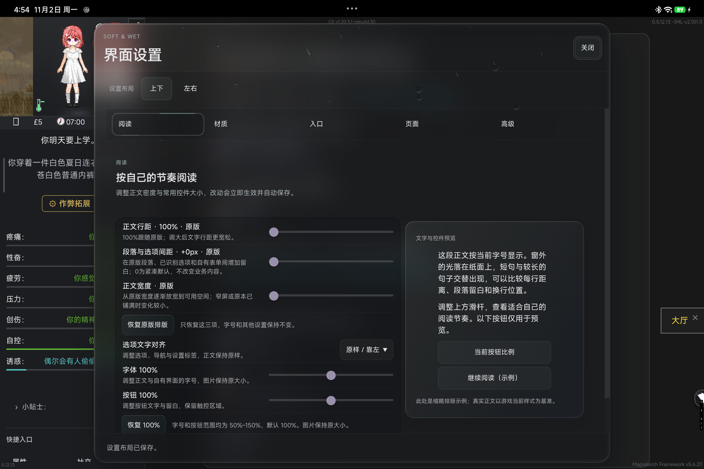
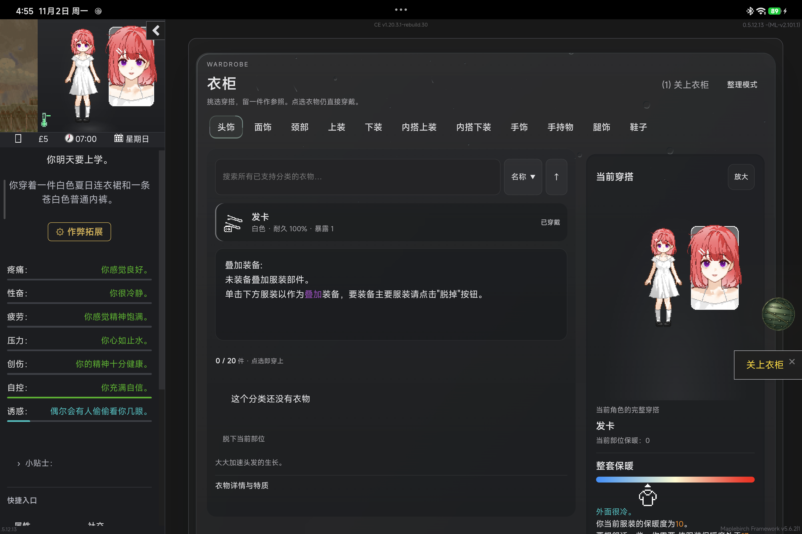
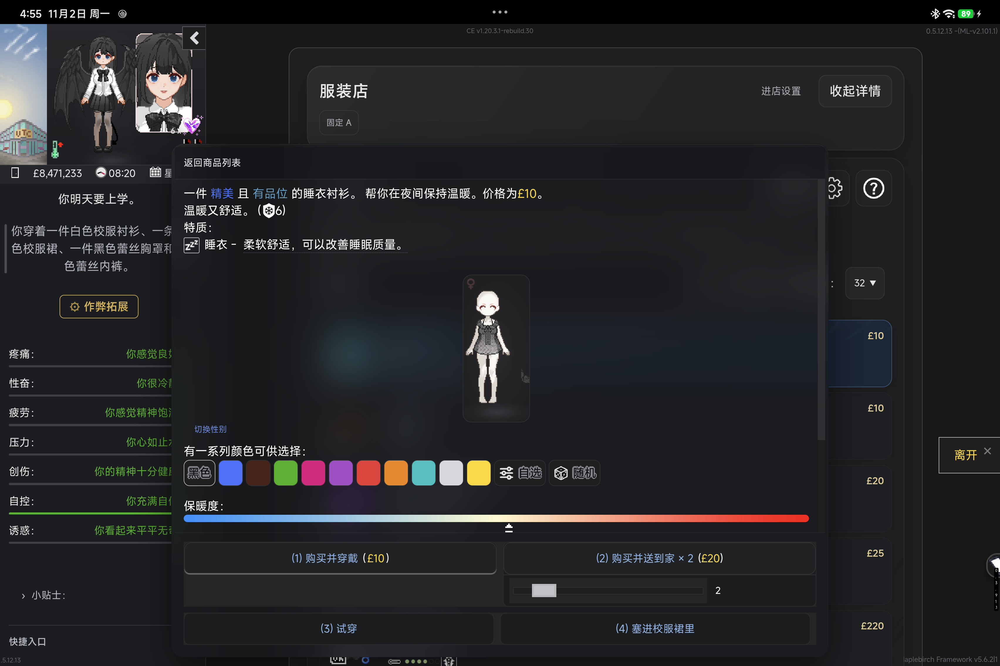

# Soft & Wet 4.1

**更通透的玻璃，更轻快的交互。**

4.1 延续黑灰 Acrylic，为窗口、阅读和悬浮工具带来新一轮调整。现在可以按喜好调节玻璃通透度，让界面在沉稳阅读与高通透之间自然变化；普通换页直接显示，衣柜更快进入。

[下载主 UI](https://github.com/102326/DoL-Game-UI/releases/download/v4.1.0/DoLGameUI-4.1.0.mod.zip) · [下载 Framework Host](https://github.com/102326/DoL-Game-UI/releases/download/v4.1.0/StoneFreeHost-0.1.5-experimental.mod.zip) · [安装说明](https://github.com/102326/DoL-Game-UI/blob/v4.1.0/docs/INSTALL_4.1.md) · [动态预览](https://github.com/102326/DoL-Game-UI/blob/v4.1.0/docs/media/softwet-4.1/android-preview.mp4) · [反馈问题](https://github.com/102326/DoL-Game-UI/issues)

> 普通玩家需要 **主 UI + Framework Host** 两个 ZIP。兼容包按自己安装的 Mod 选用，所有 `.mod.zip` 均无需解压。

## 本次更新

### 自由调节 Acrylic 通透度

新的“Acrylic通透度”滑杆从 **0–100** 连续调节，默认 **60**。向左更沉稳，向右更通透；官方窗口和已适配兼容页面跟随同一套材质，文字与控件保持清楚。

### 更细致的阅读与窗口设置

正文行距、段落与选项间距、正文宽度分别控制，默认跟随原版。选项文字可靠左或居中，字号和按钮独立调整。设置继续支持上下、左右双布局，修改自动保存。

### 悬空排列的扇形工具

Floating Hub保留金属球回旋与展开反馈。扇形主按钮独立悬浮，停靠、重置与隐藏放在内圈；网格模式保留整齐布局。拖动、停靠、快速反向和找回入口继续可用。

### 更轻快的换页与玻璃天气

- 移除三维翻页转场，普通页面直接显示；UI设置分类保留20ms短淡入。
- 衣柜直接进入，分类切换不再播放加载动画，穿戴点击反馈保留。
- 优化动态天气与玻璃的绘制，保留雨珠、雨丝、雪与特殊环境的表现。
- 改善ModHub重复依赖计算的开销，兼容窗口继续跟随主UI的通透度与显示设置。

### 商店、衣柜与原生控件修整

修复服装店详情在临界宽度下铺满屏幕的问题：窄屏使用有界抽屉，宽屏使用右侧详情，长内容可以滚动。商品选中波纹继续保留。

修正作弊页多箭头按钮高窄、图标被挤压的问题。衣柜保留搜索、当前穿搭、角色预览、参照比较与详情抽屉；已识别叠穿项目继续使用原管理方式。

购买、穿戴、战斗结算和存档仍沿用原游戏及对应Mod规则。

## 画面与动态预览

[Android 实机动态预览](https://github.com/102326/DoL-Game-UI/blob/v4.1.0/docs/media/softwet-4.1/android-preview.mp4)

## 安装与升级

DoL适配基线为 **0.5.12.13**。ModLoader需 **2.100.0或更新**，TweeReplacer需 **1.0.0或更新**；Framework Host适用 **0.1.2-experimental至0.2.0之前**，推荐使用下方附带包。

1. 保留需要的存档和原版本包。
2. 替换主UI，每个Mod只启用一个版本。
3. Host放在主UI前，兼容包放在目标Mod与主UI后。
4. 重启游戏，从“界面设置”调整通透度、阅读和悬浮工具。

本次更新ModHub、ReOverfits与万能手机兼容包；其它包可继续沿用。已有显示偏好保留。需要回退时恢复保存的旧包和顺序并重启，无需清空存档或App数据。

## 下载

| 文件 | 用途 |
| --- | --- |
| [DoLGameUI · 4.1.0](https://github.com/102326/DoL-Game-UI/releases/download/v4.1.0/DoLGameUI-4.1.0.mod.zip) | 主UI，必装 |
| [StoneFreeHost · 0.1.5-experimental](https://github.com/102326/DoL-Game-UI/releases/download/v4.1.0/StoneFreeHost-0.1.5-experimental.mod.zip) | Framework Host，必装 |
| [ModHubSoftWet · 1.0.3](https://github.com/102326/DoL-Game-UI/releases/download/v4.1.0/ModHubSoftWet-ModHub-1.3.0-plus-v1.0.3.mod.zip) | ModHub管理器、市场与帮助中心外观 |
| [MapleBirchSoftWet · 1.0.1](https://github.com/102326/DoL-Game-UI/releases/download/v4.1.0/MapleBirchSoftWet-maplebirch-5.2.3-plus-v1.0.1.mod.zip) | MapleBirch云存档外观 |
| [DolOptimizationSoftWet · 1.0.3](https://github.com/102326/DoL-Game-UI/releases/download/v4.1.0/DolOptimizationSoftWet-Optimization-1.1.1.2-plus-v1.0.3.mod.zip) | 原版优化存档、日期显示与叠穿管理 |
| [CheatExtendedSoftWet · 1.0.0](https://github.com/102326/DoL-Game-UI/releases/download/v4.1.0/CheatExtendedSoftWet-CheatExtended-1.20.3-plus-v1.0.0.mod.zip) | Cheat Extended外观 |
| [ReOverfitsSoftWet · 1.0.1](https://github.com/102326/DoL-Game-UI/releases/download/v4.1.0/ReOverfitsSoftWet-ReOverfits-4.1.1-plus-v1.0.1.mod.zip) | 额外服装槽位接入 |
| [LyraMouthCompat051213 · 1.0.0](https://github.com/102326/DoL-Game-UI/releases/download/v4.1.0/LyraMouthCompat051213-Lyra-0.5.12.13-1.0.1a-1004.1-goose-ucb-v1.0.0.mod.zip) | 指定Lyra嘴部资源适配 |
| [SmartPhoneSoftWet · 1.1.2](https://github.com/102326/DoL-Game-UI/releases/download/v4.1.0/SmartPhoneSoftWet-SmartPhoneAlpha-0.3.91-plus-v1.1.2.mod.zip) | 万能手机Alpha外观 |
| [SHA256SUMS.txt](https://github.com/102326/DoL-Game-UI/releases/download/v4.1.0/SHA256SUMS.txt) | 安装包完整性校验 |

兼容包需要另行安装对应的目标Mod。CE原作者版与独立维护的rebuild.30只能启用一个；万能手机适配包用于Alpha。

## 反馈与许可

遇到问题，请在 [GitHub Issues](https://github.com/102326/DoL-Game-UI/issues) 附上版本、设备、复现步骤与截图。

项目原创代码采用 [MIT](https://github.com/102326/DoL-Game-UI/blob/v4.1.0/LICENSE)。游戏衍生代码来自Vrelnir与Degrees of Lewdity贡献者，保留 [CC BY-NC-SA 4.0与来源说明](https://github.com/102326/DoL-Game-UI/blob/v4.1.0/UPSTREAM-RENDERER-NOTICE.md)。ModHub片段保留[原作者许可](https://github.com/102326/DoL-Game-UI/blob/v4.1.0/MODHUB-PERFORMANCE-NOTICE.txt)，Vue、Tailwind CSS、GSAP等依赖的声明随包提供。
