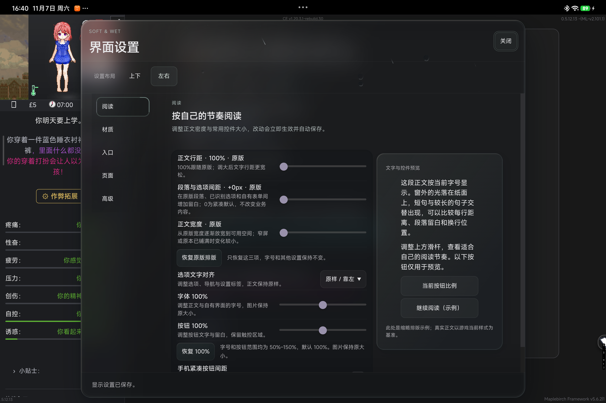
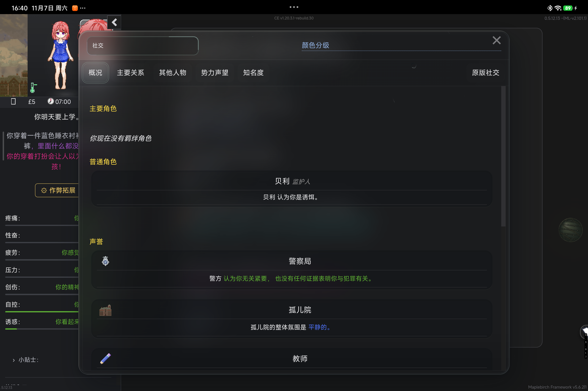
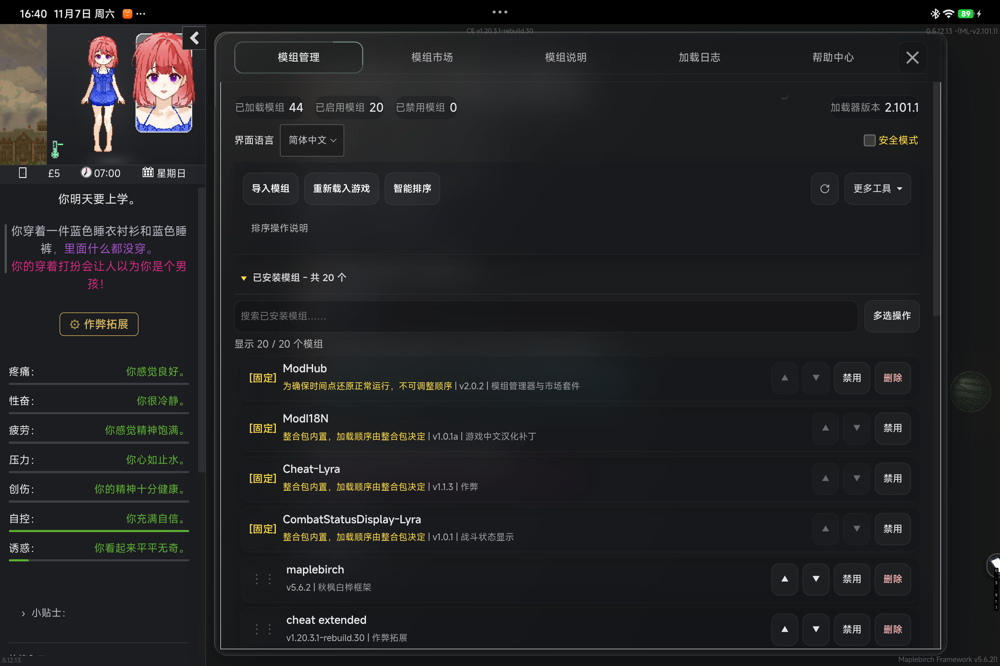
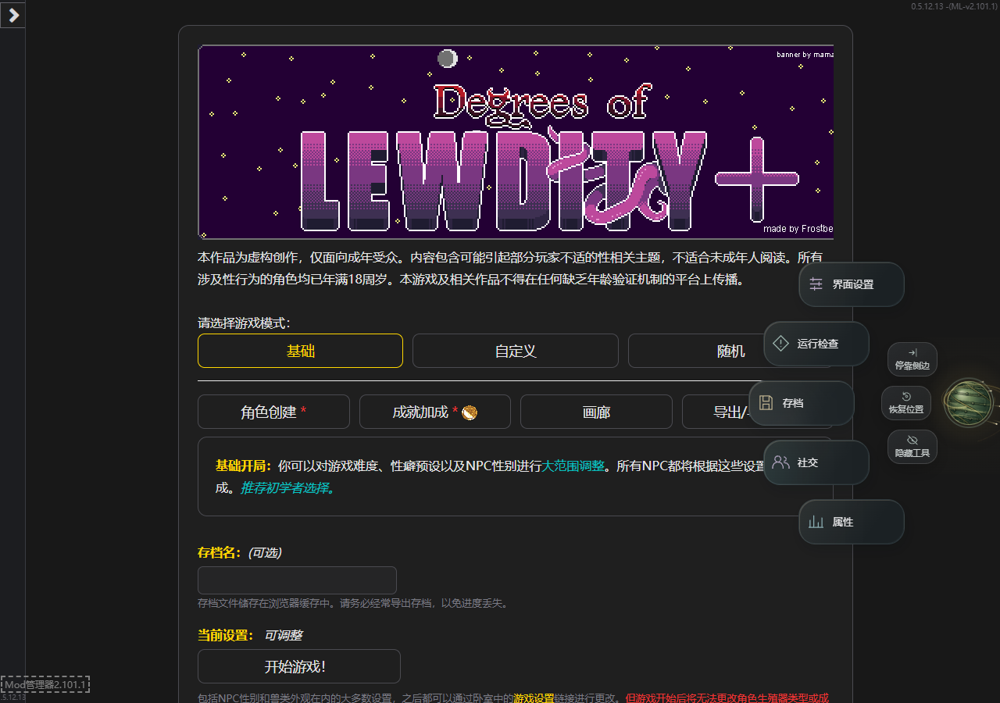

# Soft & Wet 4.2

**玻璃更跟手，悬浮工具更自由。**

4.2 延续黑灰 Acrylic、可调通透度和轻快的换页节奏，为设置、属性窗口与 Floating Hub 加入新的运动反馈，并整理界面中的重复刷新和隐藏等待。

[下载主 UI](https://github.com/102326/DoL-Game-UI/releases/download/v4.2.0/DoLGameUI-4.2.0.mod.zip) · [下载 Framework Host](https://github.com/102326/DoL-Game-UI/releases/download/v4.2.0/StoneFreeHost-0.1.5-experimental.mod.zip) · [安装说明](https://github.com/102326/DoL-Game-UI/blob/v4.2.0/docs/INSTALL_4.2.md) · [Windows 动态预览](https://raw.githubusercontent.com/102326/DoL-Game-UI/v4.2.0/assets/releases/4.2/soft-wet-4.2-windows.mp4) · [反馈问题](https://github.com/102326/DoL-Game-UI/issues)

## 本次更新

### 跟随手势的玻璃窗口

设置和属性窗口可以从标题空白处拖动。玻璃外壳与内容形成轻微的受力、延迟和回弹，雨珠与导航轮廓跟随窗口的位置与缩放。按钮、输入框和正文滚动继续沿用原操作。

设置仍支持上下、左右双布局。Acrylic 通透度默认60，可在沉稳阅读与高通透之间连续调整；原有阅读、字号、按钮和页面偏好继续保留。

### 可以放下，也可以弹出的悬浮球

Floating Hub 保留金属球体与点击展开反馈。拖动后可以原地放下；持续顶住窗口边缘蓄力，沿边移动调整方向，松手后球体带着短金色尾迹弹出，并与边缘碰撞。

飞行过程中可以直接接住，继续拖动或放下。扇形工具、网格、内圈辅助操作和原有快捷入口继续可用。

### 减少重复工作，保留现有效果

- 合并同一帧的连续拖动更新。
- 减少重复的天气状态写入和窗口反馈。
- 复用稳定霜层的局部路径与固定雨珠位移图。
- 衣柜缺少可用原生预览时，及时启动备用预览。

普通换页与衣柜入口继续直接响应，UI设置分类保留20ms短淡入。雨珠、降雨、雪与特殊天气表现继续保留。

### 兼容页面跟随主界面

已识别的兼容窗口继续使用主UI的通透度、字号、对齐和适用动效设置。ModHub管理列表与帮助中心已补充新版页面检查，时间点还原窗口也加入同一套材质与设置联动；其它兼容包按自己的目标Mod选用。

购买、穿戴、战斗结算和存档仍由原游戏与对应Mod处理。

## 画面与动态预览

[Windows 动态预览](https://raw.githubusercontent.com/102326/DoL-Game-UI/v4.2.0/assets/releases/4.2/soft-wet-4.2-windows.mp4)

## 安装与升级

普通玩家需要 **DoLGameUI + Framework Host** 两个ZIP，无需解压。兼容包按已安装的目标Mod选用。

1. 保留需要的存档和原版本包。
2. 替换主UI和需要更新的兼容包，每个技术名只启用一个版本。
3. Host放在主UI之前，兼容包放在目标Mod与UI之后。
4. 重启游戏，从侧栏或悬浮工具进入“界面设置”。

DoL适配基线为 **0.5.12.13**。ModLoader需2.100.0或更新，TweeReplacer需1.0.0或更新；Host适用0.1.2-experimental至0.2.0之前，推荐使用随版提供的包。ModHubSoftWet 1.0.4 需要主 UI 4.2.0 或更新；其它六个兼容包沿用已发布版本。

完整步骤见[安装、升级与回退](https://github.com/102326/DoL-Game-UI/blob/v4.2.0/docs/INSTALL_4.2.md)，兼容包用途见[可选兼容包](https://github.com/102326/DoL-Game-UI/blob/v4.2.0/docs/OPTIONAL_ADAPTERS.md)。

## 下载文件

前两个包必装，其余七个兼容包按需选装。第三方主 Mod 需要另行安装。

| 下载 | 用途 |
| --- | --- |
| [主 UI · 4.2.0](https://github.com/102326/DoL-Game-UI/releases/download/v4.2.0/DoLGameUI-4.2.0.mod.zip) | 必装 |
| [Framework Host · 0.1.5-experimental](https://github.com/102326/DoL-Game-UI/releases/download/v4.2.0/StoneFreeHost-0.1.5-experimental.mod.zip) | 必装，排在主 UI 前 |
| [ModHubSoftWet · 1.0.4](https://github.com/102326/DoL-Game-UI/releases/download/v4.2.0/ModHubSoftWet-ModHub-1.3.0-plus-v1.0.4.mod.zip) | ModHub 管理器、市场、帮助与工具浮层，需要 UI 4.2.0 或更新 |
| [MapleBirchSoftWet · 1.0.1](https://github.com/102326/DoL-Game-UI/releases/download/v4.2.0/MapleBirchSoftWet-maplebirch-5.2.3-plus-v1.0.1.mod.zip) | MapleBirch 云存档外观 |
| [DolOptimizationSoftWet · 1.0.3](https://github.com/102326/DoL-Game-UI/releases/download/v4.2.0/DolOptimizationSoftWet-Optimization-1.1.1.2-plus-v1.0.3.mod.zip) | 原版优化存档、日期显示与叠穿管理 |
| [CheatExtendedSoftWet · 1.0.0](https://github.com/102326/DoL-Game-UI/releases/download/v4.2.0/CheatExtendedSoftWet-CheatExtended-1.20.3-plus-v1.0.0.mod.zip) | Cheat Extended 外观 |
| [ReOverfitsSoftWet · 1.0.1](https://github.com/102326/DoL-Game-UI/releases/download/v4.2.0/ReOverfitsSoftWet-ReOverfits-4.1.1-plus-v1.0.1.mod.zip) | 额外服装槽位接入 |
| [LyraMouthCompat051213 · 1.0.0](https://github.com/102326/DoL-Game-UI/releases/download/v4.2.0/LyraMouthCompat051213-Lyra-0.5.12.13-1.0.1a-1004.1-goose-ucb-v1.0.0.mod.zip) | 指定 Lyra 嘴部资源适配 |
| [SmartPhoneSoftWet · 1.1.2](https://github.com/102326/DoL-Game-UI/releases/download/v4.2.0/SmartPhoneSoftWet-SmartPhoneAlpha-0.3.91-plus-v1.1.2.mod.zip) | 万能手机 Alpha 外观 |
| [SHA256SUMS.txt](https://github.com/102326/DoL-Game-UI/releases/download/v4.2.0/SHA256SUMS.txt) | 九个 Mod ZIP 的完整性校验 |

安装说明、截图和视频在仓库提供；发布附件包含九个 Mod ZIP 和校验清单。

## 已知问题

- 复杂天气与部分多Mod组合仍可能出现慢帧。
- 未识别的第三方界面保留原外观。

## 反馈与许可

遇到问题，请在[GitHub Issues](https://github.com/102326/DoL-Game-UI/issues)附上版本、设备、复现步骤与截图。

原创代码使用[MIT](https://github.com/102326/DoL-Game-UI/blob/main/LICENSE)。游戏衍生代码、ModHub片段与Vue、Tailwind CSS、GSAP等依赖的来源、署名和许可证随包提供。
