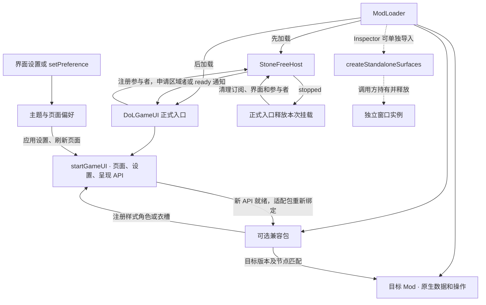

# Soft & Wet 4.x UI Runtime — API v1

玩家安装的两个包分别是 Framework Host（技术名 `StoneFreeHost`）和 `DoLGameUI`。Host 管理参与者和挂载资源，主 UI 管理玩家设置、页面呈现和公开接口。4.5 沿用 UI API v1；外部类型定义见 [UI](../src/public/ui.ts) 和[衣柜](../src/public/wardrobe.ts)。

## 从启动到退出



1. **启动。** [Host](../framework/host.ts) 发出就绪通知。[正式入口](../framework/official-ui/main.ts) 通过 [connectConsumer](../framework/connect.ts) 同时处理 Host 已在场和稍后到场两种顺序。拿到官方区域后，[startGameUI](../src/main.ts) 创建一次主题与页面偏好，传给商店、衣柜等页面，再发布呈现 API。重复的就绪通知沿用当前实例。
2. **改设置。** 设置面板将输入交给[主题控制器](../src/theme/controller.ts)。例如修改字号，应从[偏好模型](../src/theme/preferences.ts)和[读写与取值范围](../src/theme/preference-store.ts)入手；页面启停则走[页面偏好](../src/theme/page-preferences.ts)和原页面 setter。模块接受请求后更新界面，关闭总开关仍保留各页选择。兼容窗口通过已注册的角色使用主 UI 的样式。设置导航方向、悬浮菜单布局和停靠坐标各有自己的持有者。
3. **加兼容包。** 可从 [MapleBirch 外观包](../compat/maplebirch-soft-wet/maplebirch-soft-wet.ts) 起步。在同目录 `boot.json` 声明目标与最低 UI 版本，在代码中描述可辨认的节点和角色。首次加载及 `dol-ui-runtime-ready` 到来时尝试注册，保存返回的句柄；已成功绑定同一 API 时直接返回，更换 API 时释放旧句柄。原控件继续处理业务。新增包还要接入[包结构检查](../scripts/check-ci-packages.py)和[CI 制品清单](../scripts/ci/contracts.ts)。衣槽扩展走下文的 wardrobe API；指定 Lyra 嘴部资源直接走 MapleBirch 的角色层注册，独立于 UI。
4. **退出。** Host 停止时，正式入口按本次挂载释放动效、Hub、引用面板、主 UI 与参与者。页面负责归还借用的原生节点，适配包负责注销自己的监听、句柄和显示标记。旧实例再次收到销毁调用后直接返回，重建后的实例可以继续工作。Loader 单独使用 Inspector 时，走文末的独立工厂，调用方持有并释放自己的实例。

下列呈现接口接入先检查`window.DoLGameUI?.ui?.apiVersion === 1`及所需方法；衣柜命名空间独立，见后文。缺失、禁用、结构不匹配时继续使用消费者自己的原界面，不创建强制Host/UI依赖。

## 产品偏好查询

`DoLGameUI.getRequestedPreferences()` 返回主题与页面开关的用户选择快照。页面沿用原存储键；存储不可写时返回本次会话已接受的选择。总开关关闭保留各页选择。`getPreferences()` 沿用原页面状态语义：模块缺席为 undefined，页面发生故障后可为 false。页面的返回值单独于总开关，不表示此时窗口已经显示。两个查询都不执行重试。

`setPreference(key,value)` 和设置界面经同一页面 setter；忙碌的衣柜可拒绝，缺席模块不会接受新选择，故障后的显式启用可重试。Host API 不参与偏好存储。

## 查询与Style Adapter

`getTheme()`、`getVisualTier()`、`getCapabilities()`、`getDiagnostics()`和`getAdapterDiagnostics()`读取当前能力/诊断；`rescan()`请求重新识别，不改变游戏场景或业务状态。档位名是现有兼容接口，不是切换旧代主题。

`registerStyleAdapter(spec)`注册有id/version、目标版本、范围、fingerprint、角色selector和可选when的声明式外观适配。目标可用精确字符串或最低数字版本，最低比较依赖Loader的semver工具；工具缺失或比较失败不匹配，不自建宽松比较。必须通过目标、结构与安全角色匹配；未知/部分匹配按实际实现退让。返回handle的`refresh()`、`getDiagnostics()`、`destroy()`由注册者持有，退出时释放标记与监听。

## 自愿浮层

`openModal(request)`、`openDrawer(request)`接受id/title、消费者自己的HTMLElement和onClose，返回只读handle或null；handle提供`close()`及`isOpen()`。消费者保有业务与节点语义，不能通过显示API重试交易或保存。onClose原因包含api/button/escape/backdrop/disabled/destroyed/failed/native；同一窗口的关闭清理应幂等。`openInspector()`只提供诊断入口。

```ts
const ui = window.DoLGameUI?.ui;
const surface = ui?.apiVersion === 1 && ui.getCapabilities().surfaces
  ? ui.openDrawer({id: 'MyMod-details', title: '详情', content,
      onClose() { /* 释放消费者自己的订阅和引用 */ }})
  : null;
// null时保留原界面；退出时surface?.close()。
```

主动贡献Source/View/Command使用独立[Host合同](HOST_4X.md)，不能把UI API v1当成Host协议，也不向第三方暴露官方Store、Vue实例或内部DOM索引。兼容降级、节点/事件、存储与清理都按现役测试保持；版本号出现1不表示这是1.x产品文档。

## 独立衣柜命名空间：wardrobe API v1

`window.DoLGameUI.wardrobe`独立于`.ui`。按需检查`apiVersion === 1`、`registerSlotMapping`及`getSlotSupport`是否存在；不能用UI呈现API的能力检测替代衣柜检测。事实源为src/public/wardrobe.ts与src/wardrobe/main.ts，现役ReOverfits兼容包实际使用此入口。

`registerSlotMapping({id,target:{name,versions},slots:{over_upper:'外套上装'}})`返回可幂等destroy的句柄。目标版本匹配、原库存/定义/穿戴结构存在才允许展示；重复id、重叠槽位、覆盖核心分类或非法字段抛错。消费者应捕获失败并保留原入口。注册者撤销自己的映射，Core销毁后旧句柄失效，API实例更换后重新检测/注册。

映射只扩展展示语义，不接受业务状态、任意回调、操作执行器或库存镜像，不代替原生穿戴链。槽位作者必须保证既有wear_<slot>/updatewardrobe及整理操作真实可用；私有库存或专属操作应保留原入口，不假装原生业务。注册/撤销刷新分类并取消尚未执行的整理确认；已开始的原业务按既有流程结束，不擅自重试。

`getSlotSupport()`返回冻结的slot/label/mapping/canDisplay/operationContract/reason记录，不暴露库存、节点或游戏变量。reason包含native-slot、mapped、registration-required、target-not-detected、unsupported-version、missing-native-data、wardrobe-unavailable；operationContract区分vanilla、author-declared-native、unreviewed。canDisplay只表示展示结构条件，不能证明当前操作可用；author-declared-native只是作者声明，仍须校验当前页面、原对象和索引的新鲜度，不代表Core审过所有第三方业务。

## 可选的独立窗口入口

使用 Node 26 和锁定依赖运行 `npm run surfaces:build`。构建入口为 `src/runtime/standalone-surfaces.ts`，可向加载器提供 `dist/standalone-ui/index.js`。同目录包含 TypeScript 声明、许可与 `SOURCE.json`。跨设备交付请在干净的指定提交构建，核对来源 HEAD、dirty 标志和入口 SHA-256。完整 UI 和 Host 保持原有启动方式。

```ts
import {createStandaloneSurfaces} from './standalone-ui/index.js';

// 在消费者激活时创建；结束时由同一消费者调用 surfaces.dispose()。
const surfaces = createStandaloneSurfaces(window);
const panel = document.createElement('section');
const handle = surfaces.openModal({id: 'inspector', title: '检查器', content: panel});
```

导入没有挂载副作用。工厂按传入 Window 创建实例，独立持有样式和容器。调用方传入同一文档内尚未挂载的内容节点。同一实例重复打开相同 ID 和种类返回原句柄，改换种类须先关闭。用 `handle?.close()` 关闭后，可用原节点重开；节点状态、监听及业务数据归消费者。实例 `dispose()` 幂等，释放后需要重新创建实例。其它实例独立工作。

可用性由 `available()` 查询。能力不足时打开返回 `null`，原生打开失败会归还内容并通知 `onClose('failed')`；参数不合法会抛错。加载器自行选择默认呈现和失败提示。Sticky Fingers E35 的显式构建参数使用上述 JS 文件路径。运行 `npm run surfaces:test` 可复核产物导入及中性节点的所有权与生命周期。
