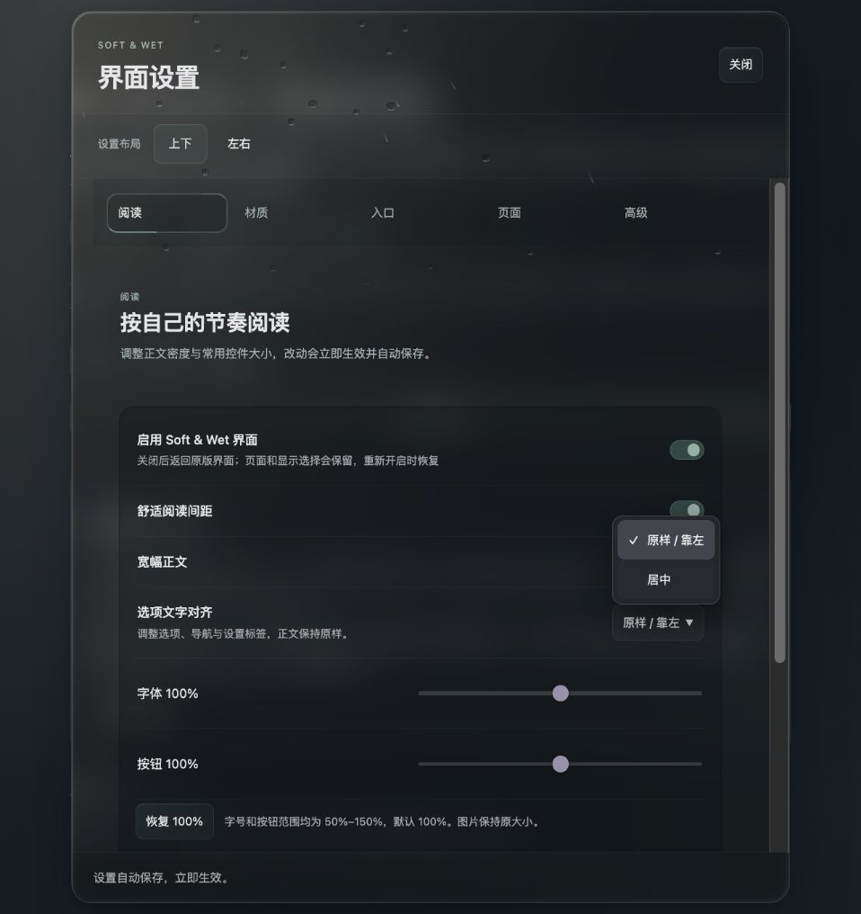
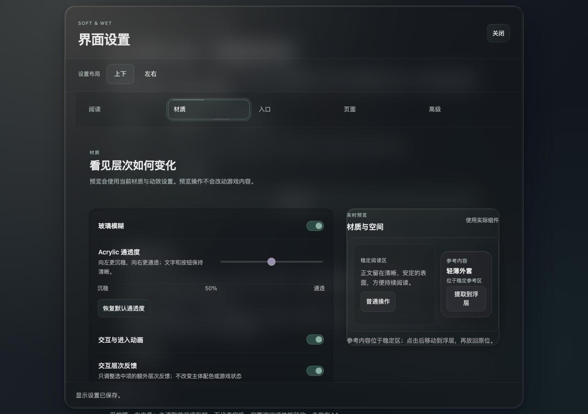
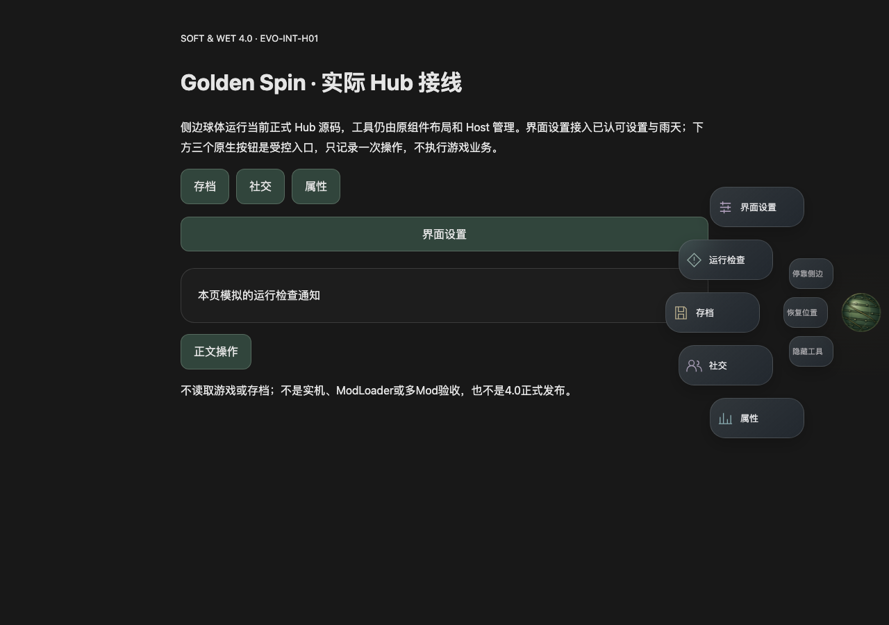

# 4.1 界面定型首批：7 / 6 / 5 与文字对齐

2026-10-27负责人追加：保留高级「回退原版界面／启用新版界面」，移除阅读页「启用 Soft & Wet 界面」总开关，传统平铺分支同样去重。仅删除两处重复控件，`setMaster`、高级按钮和渲染失败时的应急按钮不变。复用settings-retirement回归，旧模板先被「总开关数量应为0」拒绝；新版两布局的按钮存在、停用/保存/重启及重新启用后其它偏好精确保留通过，tooling:build/typecheck通过，实际阅读/高级预览已核对。本次仅本机定向验证，下面c3b280f双CI按当时源码读取，不视为本次增量的远端执行结果。

## 最终研发交付状态

最终运行代码为`76afc72`，包含报告/证据的验证提交为**c3b280fe67007766bd01b5c8b4340a9709a654cf**。标准[40468311476](https://github.com/102326/DoL-Game-UI/actions/runs/40468311476)与研究[40468315629](https://github.com/102326/DoL-Game-UI/actions/runs/40468315629)均为workflow_dispatch、Attempt1、success；各自独立下载验收成功，标准质量门成功。标准约14分27秒、研究约10分26秒，含环境准备；未改push触发范围或检查名。后续收口仅文档/证据，不能写成CI在后续HEAD实际执行。

Mac完整下载复算：标准192文件/943,377字节、研究479文件/127,601,523字节；完整计划、源码、Run/Attempt、独立校验日志中的nonce/manifest锚点及逐文件大小/SHA相符，无遗漏。研究外层ZIP123,179,072字节匹配GitHub Artifact SHA，直连慢后经同一Artifact的连接器缓存完成，没有截断报告。9个开发ZIP与10条摘要通过，制品报告逐字节等同已锚定标准证据；两轮invocation不同，56成员的内容、压缩字节与全部元数据由现有Python archive_snapshot复算一致。初次直接比较Python tuple与JSON array不等，按原JSON编码规范化后严格比较，不放宽数据值或ZIP合同。

标准37个unit入口、42个browser入口完整通过，包含新增真实picker Escape、清理/选择框composed合同；研究完整通过，含本轮菜单响应/打断。**精确版本、依赖和包合同由Python检查器执行；整轮汇总器核对身份、规定结构和一致性。** 详见[最终CI与下载收据](ui41-mac-20261027/final-ci-receipt.json)与[交接](../HANDOFF.md)。原始大证据和九ZIP不提交Git，Actions标准保留7天、研究14天；内部候选包仍使用4.0.1版本，不得当成正式新Release。

当前本机批次已收口。新增菜单时序/选择框等待负责人体验；真实归一化catalog、完整游戏/ModHub安装更新、多Mod、Android触控/软键盘/返回键与GPU、Windows原生弹层仍待回家对应环境。没有正式接入ModHub算法候选、全局材质推广、Host迁移、main合并、4.1发布或保护规则变更。

2026-10-27追加收口：原始V1冻结HTML已实际运行，在同1280×900预览的一次观察中，首次可见/展开完成/收起完成分别约514/748/650ms；新候选约11/244/233ms。见[观察数据](ui41-mac-20261027/hub-v1-observation.json)，原速录像只在本机outputs，不假定异机可见；这不是多轮性能基准或真机收益。

新增修复 `76afc72`：真实原生可定制picker的Escape目标是OPTION。设置原key处理器抢先preventDefault，会让picker无法退出且外窗进入leaving；实际入口回归先超时拒绝旧实现。修复设置后又用真实layout捕获＋兼容窗口夹具复现同类问题。内部小函数`isOpenSelectEscape`让三个自有处理器（设置、layout捕获、商店详情）先放行浏览器收picker；第二次Escape仍按原路径关闭窗口/原生overlay/详情，backbutton合同不改。非Escape先返回，不新增全局监听、轮询或查询扫描。实际built启动组合及真实商店组件已通过，命令/源码见[补充收据](ui41-mac-20261027/escape-receipt.json)。不扩张为已验证所有第三方键盘业务。

前置源码`0ede042`的标准[40465953127](https://github.com/102326/DoL-Game-UI/actions/runs/40465953127)与研究[40465957683](https://github.com/102326/DoL-Game-UI/actions/runs/40465957683)均成功；**它们不包含76afc72，不能作为最终Escape修复证据**。最终源码双CI另行手动执行并按HANDOFF记录。

## Mac收口与菜单响应候选（2026-10-27）

代码 `3554456`（共享原生选择框、HC-07）、`557f9f7`（菜单响应），ModHub研究另见[B3接续](EVO-4.1-MODHUB-B3-2026-10-27.md)。以下旧“尚未实施”按日期读取，本节覆盖当前本机交付状态。正式版本仍4.0.1；main、Tag、Release、Host协议与远端规则不改。

**EVO41-UI-SELECT-01**：共享`src/ui/owned-select.css`已接入实际UI。覆盖设置/悬浮设置、自有导航、商店默认过滤、衣柜分类/排序/转移，以及完全匹配ModHub的市场/帮助select。支持`appearance:base-select`和`::picker(select)`时用深灰展开层、44px选项、选中/禁用/长文本样式；无支持时保留原生选择器并提供dark颜色提示。保留原select节点、change事件、导航选后重置、焦点和键盘语义；排除multiple/size、未知或未匹配第三方。未新增JS下拉框或依赖，不宣称旧Android／Windows系统弹层可强制美化。

实际设置的白色展开层已在本机预览中变为深灰。生产构建CSS在8类结构、320/1100宽度下的选择/取消/键盘/禁用/焦点/长选项边界通过；off及未匹配区域恢复，强制fallback CSS分支可选，但不代替旧引擎实测。实际设置4组宽度/布局/150%字号的同轴、保存与默认左布局恢复复跑通过。默认左对齐与材质60%保留；**本次新增展开层仍待负责人视觉体验**。

**HC-07／#31第8项**：独立方案审查后完成局部根退出隔离，不迁移Host机制。保持motion→Hub→shelf→UI→owner→根属性恢复顺序，先幂等锁定、保存回调并清引用，各阶段分别尝试；根入口以AggregateError保留所有清理错误，初始化与清理同时失败时不覆盖初始化原错。真实connect继续原有固定警告合同，**没有新增玩家日志诊断**。

实际官方入口故障测试先在cd67fa4旧main复现`motion global removed`失败，再通过12场景：各阶段/多故障、重复与重入退出、清理中ready后再次健康重连、已有/第三方根属性、初始化＋清理错误、peer保留。故障插在真实清理之后；catch仅在测试中加只读捕获以观察根抛错。不能据此证明故障阶段内部中途失败的未知资源必然清完，也不宣称任意同步ready重入即时成功。两个helper通过composed includes绑定声明锁，未删原启动检查。

**EVO41-HUB-RESPONSE-01**：负责人反馈弹出慢后，对照个人原始V1档案，`hub-motion.ts`除匿名属性名外与当前相同，均为500ms门控＋240ms展开、650ms收起。新候选取消门控，菜单与球体同时开始；240ms展开／220ms收起，反向按剩余距离、最低60ms；球体自身回旋/收束保留，原生业务派发不变。不是“恢复V1原速度”，也不是此前视觉认可的自动延伸。

首项响应断言在旧实现实际失败，再通过8项Hub＋8项输入＋3项生命周期、12项实际集成及48组布局。新断言额外保证按住/键盘聚焦发生在**仍在运动且已暂停**时：本次指针q=.821494、键盘q=.717312，不能用动画已结束的位置不变冒充运动中暂停。连续反向保留q/球体角度，展开中选择单次、取消/拖拽/窄触控模拟/隐藏恢复/减弱动态与资源退出均通过。**时序候选待负责人体验**。

证据：[本机收据](ui41-mac-20261027/receipt.json)、[源摘要](ui41-mac-20261027/SHA256SUMS.txt)、[选择框](ui41-mac-20261027/select.json)、[清理](ui41-mac-20261027/cleanup.json)、[菜单输入](ui41-mac-20261027/hub-input.json)。Node26.12.1/macOS arm64/Chromium153；ci:check、Framework构建与定向合同退出0。首次`npm run framework:build`在最后`python`别名缺失处退出127，JS构建完成后以`python3 scripts/package-framework.py`成功补齐；不把失败命令写为通过。初次浏览器沙箱启动受限，改在沙箱外完成已授权测试。旧设备/游戏证据不借用为本批通过。研发推送与双手动CI见HANDOFF最新状态；未触发不算通过。

## 居中排版修订（2026-10-27）

**负责人已通过 `699a7a2` 居中排版，默认继续左对齐。** 以下“待视觉验收”为当时交付状态，现由本裁决替代。新增 **EVO41-UI-SELECT-01** 接续：截图中的展开选择框白底、浅色未选项与当前材质不协调，后续连同其它自有窗口/已审兼容界面的同类选择控件一起美化，不能只更新设置。先盘点实际select、原生系统弹出层与已有自有组件；按平台核对键盘、触控、焦点、长选项与兼容回退，不能假定CSS能在所有WebView接管系统弹层。此项已记录，尚未实施，不打断当前ModHub性能主线。

已定位首批自有消费者：`src/theme/SettingsPanel.vue`（对齐/衣柜等设置）、`src/floating/Settings.vue`（展开模式）、`src/panels/Navigation.vue`（跳到分组）、`src/shop/Toolbar.vue`（进店默认类型）、`src/wardrobe/WardrobePanel.vue`（分类/排序/转移）。兼容包已有`.modhub-help-choice select`样式属于匹配成功的ModHub外观范围，展开菜单也需单独核对。共享的是视觉规范与交互质量，不强行替换第三方业务控件；不能把外框深色当成原生展开层已经美化。全局材质推广仍需按消费者验证，不因本次记录自动完成。

负责人指出原方案只有文字居中、控件仍在右边，缺乏平衡。本地实现 `699a7a2` 将**已识别设置行**改成标题/说明在上、控件在下的同轴排布；范围只在`centerOptions=true`时启用，默认仍false/左对齐。开关沿标题中轴放置，滑杆/下拉框宽度上限22rem、窄屏自动收缩；滑杆刻度与实际输入等宽同轴，恢复按钮和页面引导按组居中。正文、文本输入、未知第三方控件及导航命中尺寸保留。页面会使用更多纵向空间，保留原滚动与双布局。

修复了实际复现的关联问题：排版切换不一定改变外壳尺寸，天气层的保护矩形曾保留旧坐标。复用原MutationObserver额外观察根节点的居中属性；没有新增观察器、轮询或动画，恢复左对齐同样刷新，销毁沿用原清理。

验证：Node26/macOS，`npm run ci:lock`、`npm run ci:check`、`node scripts/build-framework.mjs`、`node tests/ui41-option-alignment.cjs`、`node tests/weather-dom-writes.cjs`、`node tests/evolution-weather-integration.cjs`最终均退出0。实际组件覆盖1280上下/左右、390正常/150%字号四组；同轴、换行、无横溢、键盘开关/滑杆、下拉选择、保存/重载及左对齐几何恢复通过。原有导航/未知控件边界保留；原来“所有行位置完全不变”的测试按本次获授权的排版变化改为保留导航/文本尺寸与左模式精确恢复，并新增实际同轴断言，旧文字居中规则被新断言拒绝。窄屏滑杆与刻度的4px宽差已修复。

天气DOM合同新增居中切换保护矩形用例，先复现`centered:false`再通过；原6项保留，共7项。W01九检查点通过。声明锁只更新该新增用例、摘要与断言位点，不删除原检查。[修订证据](ui41-20261027/centered-r2.json)、[桌面](ui41-20261027/centered-r2-desktop.png)、[窄屏](ui41-20261027/centered-r2-narrow.png)已保存，旧证据不覆盖。

**新居中排版为待负责人视觉验收的研发候选**；60%材质已通过的裁决继续有效，不因本次重复申请。未做实机/完整游戏/性能对照、未推送、无新增远端CI，未合并main或发布。第2项ModHub接续仍按原计划，不夹入本次排版补丁。

## 当前材质修订（2026-10-27）

**负责人已视觉通过 `ee36aaf` 的通透度范围，要求保留当前默认60%并继续后续UI任务。** 本节此前的“待视觉验收”现由本裁决替代；不自动扩大到其它窗口、整体性能或发行验收。

负责人反馈低端太黑、高端不透后，本地实现 `ee36aaf` 调整候选范围：0%使用中性灰外壳与灰色承载层，避免近黑叠层；默认移到60%，保持原V1平衡材质；100%恢复4.0.1设置外壳的底色 `#24262ad9`、无背景模糊、透明控件承载层和淡蓝入射光。已对照 `v4.0.1:src/theme/settings-workspace.css` 与实际非review级联。保留新布局/边缘，不声称整窗逐像素等同4.0.1。

这里的通透度同时改变色彩、散射与承载层，不是单一alpha：60→100时外壳alpha回升，但模糊逐渐退出，背景细节可见。中间档的感知连续性仍待负责人体验；已保存数值不自动清零，点击恢复默认才切到60%。仍仅review标记启用，未全局推广、未推送或新增Actions。

同一Mac/Node26环境，`npm run tooling:check`、`npm run typecheck` 与 `node tests/ui41-material.cjs` 均退出0；后者覆盖1280×900、390×844的0/25/50/60/75/100共12个样本，以及键盘、限幅、保存/重载/失败、关玻璃回退、模态输入、主开关与销毁。已查看两端和默认截图，并在可见浏览器中显示60%大雨场景。结果及源码摘要见[修订收据](ui41-20261027/material-range-r2.json)。没有重跑未受影响的Hub完整矩阵，也没有新增实机、游戏或性能结论。

下文及原收据保留首批历史状态，50%默认和20–28px模糊范围已被本节取代；原证据文件不覆盖。

2026-10-27。关联 Issue #31。实现提交 `8403c3a291e61acdcdfa33ac58463e04d919162e`，分支 `feature/4.1-ui-material-hub`；从已同步的 `07b152c` 隔离。本批已本地提交，**尚未推送或新增远端 Actions**，不将历史成功 Run 算作本批验证。[Issue #31 本批简报](https://github.com/102326/DoL-Game-UI/issues/31#issuecomment-6432630292)已发布。

## 做了什么

| 编号 | 本批交付 | 当前状态 |
| --- | --- | --- |
| EVO41-UI-7 | 原始 V1 / Q1 样式按实际组件选择器接回；同一套材质提供 0–100% 连续滑杆，50%为原稿平衡锚点。外壳、阅读承载与预览层联动，文字和整窗 opacity 不变；保存、恢复默认、关闭玻璃及失败提示可操作。 | **隔离交互预览完成，待视觉裁决**；仅 `data-evo41-material-review` 启用，未替换正式默认材质，未全局推广。 |
| EVO41-UI-6 | 两个设置入口撤销紧凑状态间距；旧 true 迁移保存为 false、运行 API 拒绝重新激活、遗留属性清理。基础紧凑排布、手机紧凑按钮与宽幅正文保留。纹样移到材质，高级实验按兼容回退整理。 | **明确范围已实现并定向验证**；衣柜隐藏列表、商店延后绘制和按页生成继续原默认/独立开关，没有未经兼容验证全部内置开启。 |
| EVO41-UI-5 | 外圈五个实际工具、内圈三个小弧形辅助项，扇形无公共背板，网格保留面板。修正球心坐标和旧辅助区空白，正常空间相对球心垂直居中，边界必要避让。 | **研发候选已实现并验证**，待负责人体验。保留原球体、动画与业务派发。 |
| EVO41-UI-ALIGN | 阅读设置新增原样/靠左与居中切换；覆盖设置标签/分类、已识别的侧栏/页签/自有导航与Hub文字，保存后可恢复。 | **研发候选已实现并验证**；正文、输入值、未知第三方节点不调整，不宣称覆盖所有业务按钮。 |

预览：`node scripts/preview-ui41.mjs`，打开 `http://127.0.0.1:5204/?settings&weather=heavy`。先 `npm run tooling:build` 与 `node scripts/build-framework.mjs`；需要锁定 Node26 依赖。端口占用时可导入 `createUi41PreviewServer` 选择其它端口。正文与原生入口是第一方夹具，不读取游戏或存档。

材质滑杆位于「材质」，对齐选择位于「阅读」，扇形/网格沿用「入口」内原设置。关闭设置后可操作球体；Alt+1/2/3 切晴/雨/雪。新端点与范围等待实际视觉反馈，不作为性能档或物理透射率。

## V1 来源与实际差异

负责人提供 `SoftWet-UI-Design-V1-20261027.zip`，ZIP SHA-256：`ef2109b81b6690abf60e615ba61c7ac8b04e07e862e5965c56e92269826cd9e0`。174 条负载摘要和 CRC 通过；冻结 HTML 身份为 `b31d3732707b3d9dfdde1c3c3a0de9694914e4d51a1d02d2847cbcbe6fe3a864`。原始档案仅只读访问，未上传或覆盖。

`src/theme/acrylic-v1.css` 从原 `source/lab/quartz.css`（SHA `f9758adb1d3c69fe991f3de049d3d2b4ca634f2f9a9521f5c3f1609bbc99325d`）适配匿名选择器、范围 gate 和参数，不采用已作废 V2/轻盈修订。50%外壳 alpha .43、承载 .28、预览 .37、blur24px；0/100%分别为候选范围，新增控件和本批设置整理使整窗内容与冻结截图不同，**不声称新版整窗逐像素相同**。

没有新增持续绘制的装饰循环、外部依赖或新 Host 协议。日/夕照/夜的原稿变量保留，但本轮未开放光源切换；夜间原稿着色仍是静态参数，未来若接入真实时段需另行核对滑杆联动。

## 验证及修正

本机 macOS arm64 / Node26.12.1 / Playwright1.63.0 / Chromium153.0.8010.12。完成：

- `npm run ci:lock && npm run ci:check && node scripts/build-framework.mjs`：退出0；维护的源声明锁同步，应用/Framework/预览与工具类型检查及实际构建通过。
- `node tests/ui41-material.cjs`：退出0。实际源＋完整生产样式，1280×900与390×844，五个通透值。最终blur实际为20/22/24/26/28px；背景/承载联动，文字 opacity、外框几何不变；键盘输入、无效数值/限幅、保存/重载/失败、主开关/销毁和模态阻挡通过。组合中的Hub关玻璃不透明回退与文字对齐传递也通过。
- `node tests/ui41-settings-retirement.cjs && node tests/ui41-option-alignment.cjs && node tests/settings-ci.cjs`：退出0。旧值退役、保留功能、两种设置入口、文字恢复/长中文/命中、现有设置生命周期及W01天气合同实际执行。后续仅改隔离材质CSS的部分由最终材质检查覆盖。
- `node tests/evolution-hub-integration.cjs`：最终退出0，12检查点与48组实际CSS布局；包括两侧、fan/grid、正常与上下边界、窄屏/旋转、可达性与无重叠。48是布局样本，不是真机数量。
- 沿用本批未变输入和生命周期源码的 `golden-spin-hub-input.cjs` 8项、`golden-spin-hub-lifecycle.cjs` 3项通过证据。最后内弧CSS修订后复跑受影响的完整Hub合同/矩阵，没有重复跑无关球体套件。

菜单向上偏在修复前实测球心450、菜单中心422、工具组中心393；新的矩形断言拒绝该旧偏移。内圈直列也先被新增弧度断言拒绝，再调整为左右镜像8px的小弧，64×44px命中不变。

独立只读审查发现并已修复两个真实CSS问题：通用blur变量被局部24px覆盖，改用独占材质轴变量；原稿 `!important` 背景覆盖Hub关玻璃回退，补显式不透明路径。两项都进入最终组合回归。最初测试只检查默认blur，不能证明端点联动，其结果按原范围保留，不冒充最终验证。

初次新增测试有TS元组类型错误，修正后工具链重新通过；没有靠放宽断言、增加固定等待或反复重跑掩盖失败。独立审查的源级矩阵与原节点单次派发/销毁也完成，未发现其它确认阻断。

证据入口：[收据及逐文件源码身份](ui41-20261027/receipt.json)、[材质](ui41-20261027/material.json)、[Hub合同](ui41-20261027/hub.json)、[48组矩形](ui41-20261027/hub-layouts.json)、[摘要清单](ui41-20261027/SHA256SUMS.txt)。共8个受控负载及摘要清单，约1.13MB；不含游戏、存档、设备标识或原始大日志。Hub旧结果的 source 字段为当时工作树基点07b152c，实际候选身份以最终收据及逐文件摘要为准。

## 未做与接续

- 未全局整合新材质、未取得本轮视觉认可；高通透端是否足够接近负责人期待的4.0.1玻璃，需预览裁决，不能以参数或技术PASS代替。
- 未内置尚缺兼容证据的实验策略；没有为了精简设置牺牲失败回退。
- 未做完整游戏/多Mod、Android/WebView、软键盘、其它浏览器或GPU/功耗/帧率比较；没有性能收益结论。
- 未开始第3/2/1/4/8项新实现；已有性能候选、HC-07及负结果继续保留，不撤销旧调查。
- 未推送、本批无远端CI/PR检查、未合并main、未改版本/Host API/规则或发行。Git中可保存的证据与本机预览服务分开；换设备须先同步研发提交并重建依赖/服务。

本批设置子任务按当时授权用Terra/xhigh，Hub与独立审查用Sol/high。用户随后更新为默认Terra/high、特殊审查Terra/xhigh、最终架构由合适Sol主代理裁决；后续按新规则，不回写已完成的模型历史。当前没有新的架构裁决或主代理配置修改。

建议先体验本批预览并裁决材质范围/菜单布局；第6项实验策略的内置仍需对应业务证据。收到视觉结论后按7→6→5收敛，再进入持续天气性能主线。
