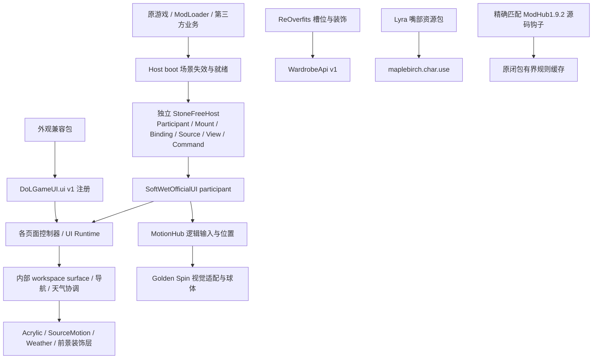

# Soft & Wet 4.2 — R0 调查与首批研究提案

> 后续设计口径已由负责人纠正：延续Claude原方案，收束应用范围；Hub优先自由悬浮，不强制吸边。本文P-A/P-B为R0历史建议，当前以 [计划V1.4](../superpowers/plans/2026-11-02-soft-wet-4.2-r1-review-plan.md) 及 [R1原方案对应记录](EVO-4.2-R1-2026-11-02.md#claude原方案校准2026-11-02) 为准。

2026-11-02。**本页保存R0时期的事实与提案；后续联合评审已批准首批小样，当前结果见 [R1执行记录](EVO-4.2-R1-2026-11-02.md) 与 [HANDOFF](../HANDOFF.md)。** 下文“尚未开始/仅文档”按当时阶段读取，CI迁移及产品正式集成仍未开始。本页接续现有演进记录，不另建开发路线图，也不是冻结功能清单。

输入：[综合交接原文](../references/SOFT_WET_4.2_RESEARCH_HANDOFF_2026-11-02.md)，SHA-256 `4138021cdfacf4e547c7678b9298f9fca68354cb9d100f9142d1ab32fc8bbbcb`；[本轮在线摘录](EVO-4.2-R0-SNAPSHOT-2026-11-02.json)。原文的建议、负责人决议和历史快照分别保留，不把“建议实施”转为本轮授权。DoL FerriteCore、独立性能 Mod 和 Paisley TS-Kotlin 均不在本轮范围。

供负责人/小鸥审阅的批次安排见 [首批研究与CI优化计划书V1.1](../superpowers/plans/2026-11-02-soft-wet-4.2-r1-review-plan.md)。该计划承接本调查，尚未批准实施，不替代本页的证据与Unknown。

**后续补充方向优先**：[精准选测与集中播报决议](../references/MOODY_CI_TARGETED_COLLECT_DECISION_2026-11-02.md)已确认日常/普通PR/普通RC精准选测、大版本最后封板全量、选定范围内尽量跑完后集中报告，取代日常fail-fast建议。下文首轮账本与技术候选保留原采样身份；涉及RC/全量策略的早期建议以补充决议及V1.1为准，现行配置未自动改变。本次仅获准核对现状、同步决议和修订计划。

## 1. 基线、权限与过时信息

| 核对项 | 本轮实际结果 | 对接续的影响 |
| --- | --- | --- |
| 正式发行 | [v4.1.0](https://github.com/102326/DoL-Game-UI/releases/tag/v4.1.0)，非 Draft、非 prerelease；九 ZIP＋校验清单共十附件 | 4.1 是历史产品基线，不在本轮继续改版或补发 |
| Tag / main | Tag `9c26b0090fa21ea389c11f0471a79d5af45a577d`；main `c7d8bac67fd04d0a81e59cf4c49800a510a39a11`；文件树相同 | 提交身份不同，不能用树相同把两个 Run 身份互换 |
| 合并 | [PR #34](https://github.com/102326/DoL-Game-UI/pull/34) 已于北京时间11月2日14:39合并 | 原报告的旧 main、HANDOFF 的等待 PR 段和 #31 顶部状态已过时 |
| 本机同步 | 旧分支由 `b5cdbbc` 快进至 `9c26b00`，无本机独有提交/未提交源码；本轮从 origin/main 建 `docs/4.2-r0-research` | 原研发分支保留。当前只有文档工作；提交/推送情况见 HANDOFF，不假定已同步 |
| 工具 | 项目 `.node-version` 为26.12.1，engines 为 >=26.12.1 <27；本机所查 Node 为26.13.0 | 本轮仅做源码/文档核对，没有重装依赖或在26.13.0重验产品；不得沿用旧本机环境描述 |
| CI规则25402407 | active，默认分支 required `validate`、`moody-gate`，strict=true，bypass=[] | 保留真实 PR/门禁，不伪造状态；research 不是该规则的 required，不等于可以取消候选双流程政策 |
| 其它规则25352119 | active，含 deletion/non-fast-forward/update；有自身 bypass 列表 | “CI规则无 bypass”不代表所有仓库规则均无 bypass；其他规则例外不绕过独立 CI 规则 |
| 批次政策 | `82d48ff`，北京时间11月2日01:10:33，已写入 [CI.md](../CI.md) | 复用现行政策；本轮未触发 Actions，不重新发明“每批全量”的制度 |
| 跟踪状态 | #31/#32 仍 open，部分正文落后于发布；#33 仍 open | 记录需协调的状态，不把旧待办重新变成4.2必做；未远端改帖或关单 |

本轮允许阅读、分析、记录和提案；不修改产品/Host/兼容实现、工作流、锁、依赖、规则或公开版本。后续 R1 独立原型、正式集成、CI 迁移及规则治理分别确认范围，历史4.1发行授权不延伸至4.2。

## 2. 当前实际架构和消费者图



图中不是每条线都通过 Host；业务状态不流入材质状态。调用/所有权索引：

| 区域 | 真实入口与当前职责 | 可观察边界 |
| --- | --- | --- |
| Host | [boot](../../framework/boot.ts)、[host](../../framework/host.ts)、[contracts](../../framework/contracts.ts)、[connect](../../framework/connect.ts) | 双包，独立协议0.1-experimental；非Vue/主题/游戏状态中心。mount祖先MO、场景Binding、参与者资源；能力/方法严格核对，缺失时拒绝接入并提示，不虚构单UI自动回退 |
| 官方根 | [official-ui/main](../../framework/official-ui/main.ts) register/claim → startGameUI → Hub/motion | HC-07已改为逐阶段清理并汇总异常，保持退出次序；与4.0.1比较 Host核心/contracts/connect/boot字节未变，不需要重复立项“迁移Host” |
| 自有窗口 | [覆盖表](EVO-P0-COVERAGE.md)、[workspace-surface](../../src/ui/workspace-surface.ts)、[navigation](../../framework/official-ui/navigation.ts) | 设置、属性/社交/通用面板、存档/详情、商店/详情、衣柜/参考/drawer、战斗逐消费者。内部租约只标呈现角色，不是外部协议 |
| 材质 | [acrylic](../../src/theme/acrylic.ts)、[workspace CSS](../../src/theme/workspace-theme.css)、[foregroundPlane](../../src/ui/foreground-plane.ts) | default60/left是现行基线；UI公共Token驱动，不下沉Host。前景分层只移自有装饰，原生控件和事件留原位；设置/partial结构有不同路径 |
| 天气 | [headerWeather](../../framework/official-ui/weather.ts) → [settingsWeather](../../src/ui/weather/settings.ts) → [weatherSurface](../../src/ui/weather/surface.ts) / wetGlass | 生产完整玻璃由owner共享500ms天气读，managedPoll避免每surface再轮询；legacy独立适用，纯legacy调度可为2000ms。各surface仍有自己的尺寸/动态资源；隐藏、reduced-motion和dispose有原合同 |
| Hub | [MotionHub](../../framework/motion-hub/MotionHub.vue)、[hub-motion](../../src/ui/golden-spin/hub-motion.ts)、[sphere](../../src/ui/golden-spin/sphere.ts) | Vue拥有工具动作、持久side/y/docked和焦点，视觉层拥有q/球体；菜单展开/收束满程约240/220ms，反向按剩余距离。持久位置不是逐帧物理姿态 |
| 兼容 | [UI Runtime](../../src/runtime/ui.ts)、compat各包及 [可选适配器说明](../OPTIONAL_ADAPTERS.md) | API注册及恢复已统一；各业务/指纹仍在包中。一次schedule仍刷新全部entries，是可调查扇出，不是已测热点；嘴部/槽位不是同一种style adapter |
| ModHub性能 | [early钩子](../../src/early/modhub-performance.ts)、[rewrite](../../src/early/modhub-rule-patch.ts)、[cache](../../src/early/dependency-rule-cache.ts) | 已集成准确1.9.2+源码SHA匹配，原闭包规则缓存1024/别名256；缓存规则而非业务结果，保留迟到结果与安装语义。不匹配/能力不足保留原源码 |

### 历史结论到4.1的校准

- **已集成**：当前九包正式发行、全局偏好/材质接续、PERF-GLASS-03前景分层、HC-07局部清理、ModHub1.9.2规则缓存。依据 [最终候选记录](EVO-4.1-CANDIDATE-2026-11-02.md)、[UI报告后段](EVO-4.1-UI-765-2026-10-27.md)、正式源码；不能再用10月27日的“B3未装入”概括所有ModHub优化。
- **仅历史/隔离实验**：1.8.3 B3 hybrid并非当前1.9.2玩家实现；A1扫描次数减少未证明省时；C1/C3退化及未采用伪元素实验保留负结果。不得复活为“待整合优化”。
- **仍待现场归因**：原版 generateLinkNumbers/可见性、天气绘制/合成、adapter扇出。4.0.1的Android trace定位过调用栈，4.1已改页面/玻璃路径，必须重采才能称现役热点。原4.1只读目录计算收益不等于市场端到端开窗/FPS。
- **未重新复现**：召回残留、隐藏键盘激活、旋转丢失、低帧率不同步属于交接线索；当前源码已有inert、Binding失效、viewport stamp/cancel、visualScope清理及相关合同，不能据线索直接判新缺陷。#33是真实反馈，Ray版本与稳定现场仍缺。
- 历史1.X/2.X不全面翻查。只在相同热点重现后回看对应缓存/Observer/延迟初始化方法，记录现状是否已解决；不恢复旧主题、全局抑制或延后必要反馈。

## 3. 问题与证据缺口清单

| ID | 分类 / 现有证据 | 下一步最小调查或对照 | 当前建议 |
| --- | --- | --- | --- |
| R0-VIS-01 | 设计假设：黑灰Acrylic可通过边界光/层次与环境联动提升质感；无新样片裁决 | P-A同操作原速比对，长文/复杂背景/0-60-100三端观察 | 进入提案，不改默认材质 |
| R0-MOT-01 | 历史中断线索；现有输入与生命周期防线可查，未重现失败 | P-B对召回重抓、pointercancel、焦点、隐藏、旋转和低帧率逐项记录终态 | 先定义状态所有者，不先建万能物理引擎 |
| R0-ENV-01 | 已有共享天气读/每surface时钟/前景分层；联合拖动尚无收益证据 | P-C单效果/联合/静止背景对照，观察材质联系与重绘 | 不默认多叠粒子或用GL假设能采DOM |
| R0-HOST-01 | HC-04全条目refresh源码仍在；现场成本Unknown | 固定活跃adapter数量/同批变更，测刷新/查询/样式成本与正确失效 | P2，先UI内部dirty/发现候选；不自动下沉Host |
| R0-HOST-02 | 现有Binding/mount已共享；HC-02/03/05/06未证明新增Host API性能收益 | 跨独立消费者证明至少两个同义需求，测扇出/故障隔离/退出 | P2后续；沿用[Host调查](EVO-4.1-HOST-SHARED-SURVEY-2026-10-26.md)，无新增P1迁移 |
| R0-GAME-01 | 原生调用链有旧trace；UI关闭不是卸载或最小Mod | 现场具备时做相同存档/场景的最小与实际组合，分离trace归因和无探针计时 | 当前不改游戏算法、编号或Mod业务 |
| R0-TRACK-01 | #31/#32及旧交接正文落后于实际合并发布 | 以API/Tag/源码记录差异，后续获准同步GitHub时简短纠正 | 本轮只修仓库交接入口，未改/关闭Issue |

Host的P1仍须同时满足现场热点、低风险改法和收益证据；本轮没有新增符合条件的Host集中化项。ModHub依赖/更新算法、第三方业务、UI配色/具体动画/焦点均保持原所有者（P3不合并）。

## 4. 首批原型提案（待批准，不是施工单）

三项可往返，先做P-A/P-B获得区分力，再决定P-C是否值得制作；不需等CI平台改造。研究实现时优先TS、自有组件与原生DOM，使用独立预览状态/构建目录，不改玩家偏好、业务或Host协议。研究控件仅用于对照，不自动进入产品设置。

### P-A：内容先用的Acrylic窗口

- **任务**：打开设置，读长说明，操作开关/滑杆/选择框，切分类并立即关闭重开；以实际Settings组件与一个不同角色的商店详情组件代表验证，合成业务输入。原版4.1同视口/背景/字号/操作/原速为基线，不以设置单点代表所有窗口。
- **两条有区分的候选**：A“静态玻璃＋局部湿光”把复杂光反馈局限边框/操作位置；B“材质随受力连续形变”允许更明显层次/运动，但正文和命中平面稳定。均保留黑灰Acrylic，不用换色代替设计差异；先比较默认实现，暂不增加设置。
- **输入边界**：实际自有组件、原控件事件；不载入完整游戏、不采私有DOM截图为纹理。若研究GL折射，先以受控图像验证技术，只证明图像材质，不能声称折射了实时DOM。
- **测量/中断**：输入→处理→首个反馈→内容可操作分别标记；开后立刻改选、关闭、Escape、快速反向、窄屏/大字号、reduced-motion、渲染失败。浏览器帧采样只是观察信号，实际呈现另需设备trace/原速视频。
- **退出**：没有明确视觉收益、正文/命中漂移或额外等待无法消除，则留研究/调整，不接生产。交付可操作页面、同操作原速对照、几何/事件/清理证据与负责人视觉裁决入口。

### P-B：JELLY Hub的直接操控与召回

- **任务**：展开并选工具、拖至边缘停靠、拖动中取消、召回中再次抓住、隐藏后找回、横竖切换。以真实MotionHub逻辑+同一组工具为基线，不改业务动作与Host View/Command协议。
- **候选对照**：A“软芯贴手”只让外观形变/高光/局部回弹丰富，命中与位置控制沿现有路径；B“受约束惯性/丝线召回”探索可中断的物理姿态与受力反馈，但持久布局仅在显式操作完成时写入。B不是自由布局或UI编辑器。
- **状态合同**：逻辑输入owner、视觉clock、临时姿态与已保存位置分别定义；新输入使旧召回失效，迟到回调不得抢回位置；隐藏/inert无键盘激活，关闭后无阻挡，销毁后帧/监听归零，旋转后仍可触达。
- **默认优先/有限自定义**：先优化默认工具布局、容错和停靠；只有重复任务证明选择/排序必要，才另提可选配置，允许零新增。研究中的弹性/阻尼面板不进入玩家UI。
- **测量/退出**：分别量化贴手反馈、可选工具时点和空闲资源，30/60/高刷新条件作为测试输入而非目标设备实测；若需要牺牲可操作性、引入全局输入拦截或无界常驻循环，回到较小方案，不用跳过断言解决。现有inert/事件/暂停/清理合同继续有效。

### P-C：环境与材质/受力的联合样片

- **任务**：同一窗口由晴转雨、四档雨量、雨转雪/霜、昼夜及一种特殊天空；稳定观看正文，拖动/释放/隐藏/重开。保留现有雨滴自然分布、底边流出和轻透结霜作为可比较基线，不预选新渲染器。
- **对照**：4.1完整效果／只改材质／只改受力反馈／联合；同seed、环境序列、尺寸、操作与持续时间，先单项再联合。新候选可失败，不把旧雪/雨的认可自动搬到新组合。
- **工程问题**：先验证DOM背景可得性与模糊/前景层合成边界，检查拖动中光照/水迹是否联系可信、保护区是否泄露、无交互时是否休眠。保留未知天气/提供者抛错/Canvas不可用静态回退。
- **退出**：联合效果只是粒子堆叠、可读性下降或成本不可解释，则拆分保留研究。自动降质、物理引擎选择和Host环境公共接口均待决策，不随样片默认启用。

### 共同测量提议与所需权限

建议研究开始前固定输入与指标：首次加载、首次打开、再次打开分开；受控warm场景预热后按AB/BA交错采30对，冷场景另采至少10次，保留全部慢样本、失败和离群原因；先约定中位/p90/最差样本及计时边界，不能看完数据再换口径。样本方案是提议，真实设备执行成本高时事先调整，不把30对变成所有小改动强制门禁。

**20ms仅作为限定场景的探索目标**：分别报输入等待、处理、可观察反馈与可操作时间；JS回调完成或首个rAF不等于已上屏。受控合成输入、物理输入与设备呈现证据分开。录屏展示原速体验，不能仅由视频或rAF反推精准触控延迟、GPU占用或功耗。

进入R1需确认：选P-A/P-B/P-C中的哪项与哪一候选，允许独立TS预览/局部试验/必要依赖的范围、比较基线、可用真实宿主与设备、视觉评审方式。无需先批准渲染器；任何新增依赖先给具体收益/大小/兼容/退出理由。现有授权尚不允许制作这些新原型、正式集成或发布。

## 5. CI覆盖与成本账本

### 最新观测，而非提速结论

在线最近15次（非全部441次）跨北京时间11月2日02:07至14:39创建，均晚于批次政策提交；8个head SHA，dispatch10、PR4、push1，success11/failure2/cancelled2，均Attempt1。该小样本不能证明政策有效/失效、dispatch多余或Codex阻塞；PR事件同时验证合并输入，不能只按head去重。两次取消和两次失败保留状态，未据created→updated推算实际消耗。

两次failure分别是f294855标准与8daf1e1研究；既有[候选记录](EVO-4.1-CANDIDATE-2026-11-02.md)和[UI实施报告](EVO-4.1-UI-765-2026-10-27.md)将其定位为退役时钟取样与展开中态观察竞态。这里沿用有出处的历史归因，未在本轮重读两份失败原日志或重新复现；下游缺报告不重复记产品缺陷，首个有效失败时间仍待拆账。

| Run / 输入 | 在线结论与近似墙钟 | 本轮核对 |
| --- | --- | --- |
| [41401340265](https://github.com/102326/DoL-Game-UI/actions/runs/41401340265)，main push `c7d8bac` | success / 11分52秒 | 日志实际checkout为c7d8bac；validate/evidence-verify/moody-gate均成功 |
| [41352769456](https://github.com/102326/DoL-Game-UI/actions/runs/41352769456)，PR head `9c26b00` | success / 13分41秒 | 实际checkout `43669b5`（合并输入），三个job成功 |
| [41352769411](https://github.com/102326/DoL-Game-UI/actions/runs/41352769411)，相同PR | success / 8分54秒 | checkout同43669b5；prototype和evidence-verify成功 |

墙钟为run_started_at→updated_at近似值，不含完整计费含义。API的step时间按整秒；main producer内部日志为deps、check、unit、build、packages、browser的细粒度计时另列。三轮结果没有在本机重下完整Artifact重算，不冒充本机新验收。

| 观测 | main标准新样本 | PR标准/研究样本 | 判断 |
| --- | ---: | ---: | --- |
| check / unit | 26.735 / 32.454秒 | 标准step34 / 39秒 | 不是优先删减对象 |
| build / packages | 88.394 / 93.414秒 | 标准step111 / 122秒 | packages包含首轮合同快照、独立重建、对比和负例，不能全算二次编译；内部子段尚缺精确拆账 |
| browser | 396.182秒 | 标准step434秒 | 新main仍为最大阶段；定向范围研究优先 |
| device-layouts | 169.048秒 | 原评审180.8秒，仅作另一轮背景 | 48配置＋73扫描宽度＋2方向＋4负例=127计划项，不是48实机；无配对归因，不宣称变快 |
| 其它browser大项 | owner-resources36.994、settings-ci32.856、runtime-regressions20.280秒 | 尚未逐项配对 | 先核合同与重复输入，再决定分层 |
| research | 本次main不触发research，符合现工作流 | research step466秒 | weather多代候选/历史设置研究需消费者映射，不直接移除 |
| 独立下载verify step | main1秒，job16秒 | 标准2秒/job21秒；研究1秒/job24秒 | 下载/准备/调度与校验本身分开；不以移除Hash作为主要提速 |
| npm cache | main未命中 | 两个PR流程命中 | 最新样本并非始终命中；main依赖step仍3秒，不足以说明缓存是主要瓶颈 |

未获得：计费runner-minutes、代理真实等待/token、所有失败根因、packages子操作耗时及各research case精确duration。本轮只保存小型API/日志摘录的事实字段；完整日志和设备材料不进仓库。后续按事件/风险/profile比较；至少形成多个可比批次后才谈p50/p90成本趋势，不能把并行流程墙钟相加当用户等待。

### family与真实消费者映射（人工研究映射，不改现有分类）

现有 [research-families](../../scripts/ci/research-families.ts) 按名称分hub/settings/production/weather，非production整体标Candidate；它**没有表达某个历史变体是否现役**。保留既有锁与必需集合，先加研究判断，不把新表冒充已生效profile。

| 类别/入口 | 实际消费者或用途 | 后续覆盖建议与保留条件 |
| --- | --- | --- |
| production：framework/connect/startup/commands、UI runtime、settings、save/wardrobe/shop/combat、foreground/header/weather-special | 现役业务边界、外观与生命周期 | 受影响合同常规保留；共享层/输入/焦点/资源变化扩大。不按“研究”名称降低真实合同 |
| hub：golden-spin-b/hub/input/lifecycle、motion-workspace | 部分直接重用src球体，部分原型独立控制器/几何；窗口研究包含历史参考 | 先逐case映射生产消费和历史故障；保留输入/中断/暂停/清理，不能整族退役 |
| settings：settings-baselines/prepare/types/build/study | 固定3.0.4与b507历史对照；现行设置另有settings-ci实际组件 | 历史视觉对照可提名定期/手动；先确认没有独有恢复/失效合同，现役组件覆盖接替后才降频 |
| weather：v1/beads/film、glass/trails/runoff、levels、shower/force/scatter、weather-unit | 被否决外观与已采用模型/材料交错；wet-glass/renderer有生产重导出，旧变体仍可能承载负例 | 逐变体拆职责；现行scatter/自然湿痕/流出/雪/中断保持，V1/A/B及force旧表现仅是降频候选，不删除共享模型防线 |
| 设备扫描 | 官方Hub、窗口边界与实际样式夹具＋负向控制 | 当前standard保持；研究代表断点/手机/平板/桌面与深扫分层。布局/坐标/共享CSS改变回退完整矩阵，不扩大设备名称 |
| CI防御与包 | 错身份、缺证据、零断言、pageerror、超时/取消、完整集合、ZIP/依赖/许可/双构建 | 日常/RC分层需另批批准，廉价防线保留；产物检查器执行ZIP合同，整轮汇总器核身份/结构/两轮一致性，不复制第二套ZIP校验 |

### 四类候选及验收

| ID / 类别 | 候选与依据 | 风险、验证与是否可立即实施 |
| --- | --- | --- |
| CI42-K1 / 保留 | failure/skipped/cancelled/unknown缺证据失败关闭；实际case/pageerror/身份、路径/symlink/尺寸与完整性 | 原F1/F2/F3及错SHA/Attempt、缺文件、超时、取消必须仍拒绝。不改变现合同 |
| CI42-S1 / 简化 | 人读报告先列首个根因、case和产品/夹具/基础设施，再列连锁缺证据；成本账本优先利用既有输出 | 先离线样本派生，不改变PASS判定；有此提案不等于获准改runner。旧失败根因分类须有证据，不按exit/名称猜 |
| CI42-S2 / 简化 | source-check、evolution-owner-resources/settings-ci等跨标准/研究重叠入口的输入/断言对齐调查 | 同名非等价；配置、环境、实际checkout、构建、测试依赖和报告合同一致才能考虑复用。共享dist不再声称独立双构建 |
| CI42-F1 / 降频 | 代表布局与深扫；历史设置/天气变体；独立双构建按构建/打包/依赖/许可及RC/发布强制 | 先冻结各profile预期集合与保守回退，不能自行删当前required项。范围不明全量；漏选反例不得过门禁 |
| CI42-S3 / 简化 | context＋manifest＋case为单一事实来源，派生summary/family/人读结果，减少重复维护 | 最后才研究；每层说明独立故障模型，影子比较新旧判定及回退。producer自证不因更多nonce/hash变独立可信 |
| CI42-R1 / 移除候选 | 仅证明无现役消费者/承诺、无独有回归的旧必需实验，或确切同输入重复执行 | 本轮没有批准删除项。保留历史/复现入口；不以“从未失败”证明无用，也不因已实现永久必需 |

## 6. 分步安排、待决策与本轮终点

1. **现在完成的R0**：冻结4.1基线、真实架构/消费者与旧结论校准、15次运行/三轮jobs/日志抽样、规则与现政策核对、三项原型提案。本轮只新增/更新文档。
2. **下一批准批次可选**：P-A先做实际窗口原型，P-B并行或随后做Hub；只用定向合同与已有防线。CI42-S1先做离线报告样本和packages成本拆解方案，可与视觉研究独立推进，不阻塞R1。
3. **再决定覆盖分层**：逐case确定现役/历史/共享，离线对照显式profile的预期集合与风险回退；原profile继续有效。批准后先影子运行，再比较漏选/失败语义，保留旧入口可回退；required稳定job必须真实产生结果，不靠workflow paths跳过。
4. **最后才是协议迁移**：覆盖已稳定后单独处理context/manifest/case；新旧完整判定对照，注入错源码、错Attempt、缺文件、零断言、pageerror、取消/超时/unknown。覆盖范围、身份协议、分支治理不在同一批改变。
5. **R2/R3/R4**：早期Windows Edge/Android WebView用于验证关键输入/合成假设；随后横向消费者和联合效果，再决定集成。不是在R1把全设备全业务全部验收。正式RC/发布仍需完整适用合同、真实游戏/设备/视觉和明确批准。

| 待决策 | 当前建议 / 替代 | 尚缺证据 |
| --- | --- | --- |
| 先做哪项原型 | P-A静态玻璃/局部湿光与受力材质对照，P-B保持独立候选；P-C按前两项结果 | 负责人选择与原型实施范围 |
| 渲染/物理技术 | 保留CSS/Canvas/GSAP现状作基线，必要时比较GL或其它技术，不先换全栈 | DOM纹理可得性、组合成本、兼容与退出路径 |
| Host下沉 | 先复用现API与UI局部scope，最小共享接口提案以真实多消费者为前提 | 实际重复成本、能力协商、错误隔离和旧Host回退 |
| 20ms口径 | 有限任务的分段分布目标，不设全产品硬门槛 | 目标设备/刷新率、物理输入与实际呈现数据 |
| 自适应质量 | 维持现有用户主动偏好及失败回退；固定高质量先优化 | 降低/恢复策略和负责人明确决定，不默认自动降质 |
| 自定义 | 默认容错先行；快捷项/排序等只按任务证明价值 | 用户任务观察、成本/恢复/组合验证，可零新增 |
| CI分层 | 先账本与case映射；完整候选双流程维持 | 多个可比批次、漏选反例、维护成本和批准 |
| 跟踪同步 | 下一次明确GitHub同步时纠正#31/#32的历史状态，并关联本记录 | 当前仅本地文档，无远端编辑/推送 |

首轮R0 Done：上述六类研究交付可供选择、来源可追溯、文档链接/JSON/差异检查通过；不是R1已实现或性能已提升。当时未新跑浏览器/游戏/CI、未下载重验发行ZIP、未重现#33或中断线索；未安装新框架、改Host/依赖/工作流/保护、合并或发布。设备与原游戏验证属于后续相应阶段，当前R0无须等待它们。后续补充核对的实际测试另见第7节。

首轮文档验证：`git diff --check`；Python内置模块核对123个相对链接目标、归档原文SHA、快照JSON及15次运行/规则字段、当前HEAD和Tag树相同，均通过；当时改动清单限定为7个docs文件。没有把这些文档检查写成产品测试。文档分支当前未提交/未推送，跨设备须先完成文档交付同步。

## 7. 精准选测补充同步与现机制核对

依据原文SHA-256 `8156e2f385af5757f89164e682c96adcb3bfb8511f4bfe712eed71b1f0f54816`。负责人在范围澄清中选择「先核对现状、同步决议并更新计划书」，所以本次未实现选择器、修改CI或开启原型。

源码基点仍c7d8bac；未提交变化均为docs，运行/测试/CI源码未改。Mac arm64实际Node26.13.0，先执行 `npm run tooling:build` 编译并检查既有工具/测试来源，再分别执行：

```sh
NODE_OPTIONS=--experimental-strip-types node tests/ci-v12.test.cjs
NODE_OPTIONS=--experimental-strip-types node tests/ci-evidence.test.cjs
NODE_OPTIONS=--experimental-strip-types node tests/research-evidence.test.cjs
```

四个命令均退出0。3个合同入口实际覆盖独立检查继续、前置状态/族隔离、取消/超时/预算、缺失/过期/错身份/零断言/报告/下载证据等已有正反例。日志中的REPRO E2和F1/F2为受控历史故障验证，不是宣称当前CI又出现新假绿；整体最终合同通过。未执行浏览器矩阵、游戏、包重建或远端Actions，不将此结果冒称新策略已接入或4.2通过。

现状差距：suite循环已有继续；research有部分前置阻塞；标准workflow的默认成功条件仍会阻止部分可独立执行阶段；catalog/summary/upload/remote仍绑定完整预期，不能只传入子集绕过完整性；现summary尚未形成根因去重的行动报告。历史2.7 test-workflow仍break但不属当前Moody入口，本轮不顺手改造。

计划V1.1给出少量影响组、依赖/间接消费者闭包、运行意图、统计守恒、封板差异复测、选择身份及C0–C4迁移批次。已确认的是目标，映射和技术实现仍待评审，required/候选政策迁移需具体批准。原报告R0的15次在线采样未重采、不改写为新测数据。
