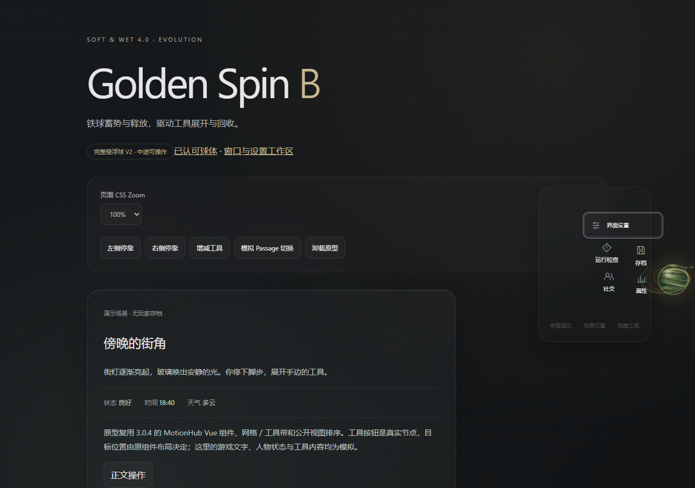

# EVO-HUB-V2-INPUT — 悬浮球演出中的真实输入

2026-10-22，分支 `dev/evolution-4.0`，输入 `5a656c602cdf5d9bf569ba9364ee46f5475e5c66`。本批推进已批准的 V2 / H1–H4，修复隔离 Hub 演出期间整段禁用工具的旧策略。精确提交和最终 CI 见 [Issue #22](https://github.com/102326/DoL-Game-UI/issues/22) 本批记录。

## 实际变化

- **V2-INPUT**：工具达到可辨识的展开位置后即可点击或聚焦，不再等待整个时间线完成。完全隐藏或仍挤在球心的控件不接收输入；收束时沿用原组件的 `inert` 语义，球体仍可接受反向。
- **V2-PRESS / FOCUS**：按下工具或键盘聚焦时暂停当前菜单姿态，球体保留自己的旋转余韵；松开、取消或移开焦点后按最新意图接续。原组件直接处理点击、详情、返回及关闭，不排队、不克隆按钮、不重放业务事件。
- **V2-LIFETIME**：拖动期间不再因每次位置变更反复重启球体收束；工具移除、减少动态、动画总开关、隐藏/恢复、场景失效及卸载有明确释放。撤销装饰时恢复原内联属性与优先级，保留后来被外部接管的值。
- **V2-EXIT**：原型唯一生效路径退出“moving 时一律 pointer-events:none / tabindex=-1”；没有另留一个可启用的旧锁定模式。冻结旧提交只用于负例，不是第二份正式实现。

保持原工具、排序、最终网格/工具带、点击与 Host 合同。没有改动 `sphere.ts` 的球体外观与演出、正式 MotionHub 组件、设置 V2.3、Acrylic 或生产天气读取；六份受保护文件的 LF 正文摘要与 V0 相同。V0 的旧 Hub 适配器摘要作为历史输入保留，本次被明确授权的 V2 改动不回写成旧基线通过。

这是隔离真实组件原型，尚未在正式 `startOfficialHub` 中启用。不宣称全量 A2/A3、G1/G2/G3 或生产交付完成。

## 观看与复现

- [桌面原速演示](../media/evolution-hub-v2/hub-input-v2-desktop.mp4)
- [390px 窄屏原速演示](../media/evolution-hub-v2/hub-input-v2-narrow.mp4)
- [结果摘要](../media/evolution-hub-v2/validation.json) / [源码、受保护输入与媒体摘要](../media/evolution-hub-v2/manifest.json)

运行 `npm run prototype:golden-spin` 后打开 `http://127.0.0.1:5181/hub.html`。录像展示 H1 展开、H2 收束、H3 中途真实点击/键盘/反向/拖动、H4 停靠与正常使用；保留等待与原始播放速度，没有剪辑或变速。工具按钮和 Host 是真实组件，详情文字与场景是第一方模拟，不读取玩家存档。

## 验证与失败记录

Windows / Node26.12 / Edge：

- `node tests/golden-spin-hub-input.cjs --baseline` 在固定旧适配器上实际失败：可见工具 `pointer-events:none`、`tabindex=-1`、真实点击未命中，原生激活计数为 0。只替换测试服务器加载的适配器模块，不覆盖工作树。浅克隆需先取得上述固定提交；缺 Git 对象不是有效反例。
- `node tests/golden-spin-hub-input.cjs` 八组检查通过：真实指针单次激活且原节点不变、按下姿态稳定、移出松开取消且继续展开、键盘激活/取消、连续反向与终态布局、拖动/停靠、窄屏中途模拟触控与125%缩放、活动时关闭动画/减少动态、隐藏/恢复、场景与owner退出、重新挂载。
- 既有球体和 Hub 检查通过。窗口工作区首次因 Mac 风格 `/@fs` 拼接在 Windows 下无法加载模块而失败；只修正测试 URL 斜线后，原五组断言通过，没有改窗口实现或放宽门槛。失败 JSON/截图保留本地忽略目录。
- `npm run prototype:golden-spin:check`、`npm run prototype:golden-spin:build`、`npm run ci:check` 通过。新增输入检查纳入既有研究命令与白名单 Artifact；不替换原检查名称。云端结果按最终提交另核对，不将本机通过写成 CI 通过。

录制时的 Windows 源码为 CRLF，Git 按现有 `.gitattributes` 规范化为 LF；manifest 同时记录实际工作树与 LF 正文摘要。媒体来源未因换行差异冒充逐字节相同；球体等冻结输入以 LF 正文及 Git diff 核对，代码语义没有变化。

## 当前状态与接续

Implemented / Windows Controlled Tested；本批完整 Hub 的视觉与手感等待负责人确认。球体、设置及天气的既有认可各自保留，不自动延伸为本批或整个 4.0 的认可。

没有生产整合、main 合并、公开版本/API变化或发布。实际游戏、Android/iOS/WebView、多Mod、Mac本机及多表面长期性能尚未覆盖；不把390px模拟触控称为真机。后续继续已批准 A2/A3 消费者迁移，Hub 的生产接入需连同正式宿主、偏好和退出路径单独验证。
