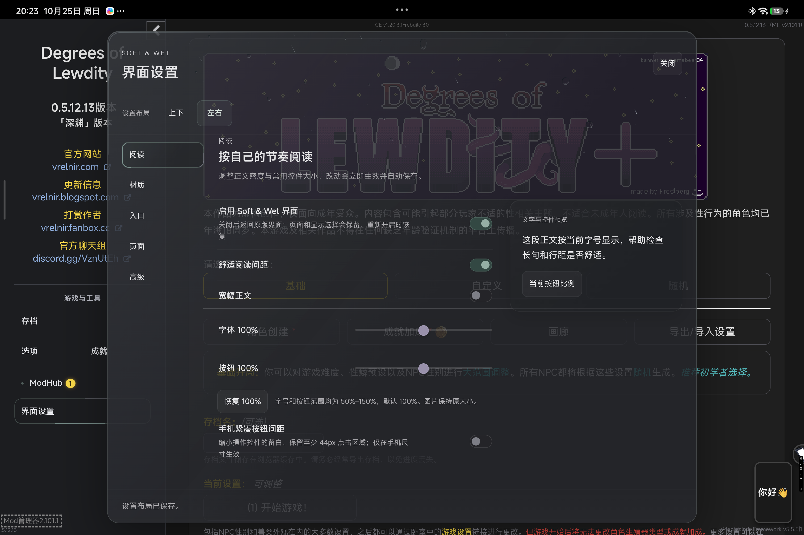

# GB40-PERF-F1：顶栏雨效收敛与实机复验

2026-10-25。运行修复为 `37d1baf`、`1c0cade49c198b5e705337f7e9a1b683f7312dcb`。顶栏方案已经实现并完成代表性功能验证，原生绘制耗时明显下降，但仍有慢帧。**负责人于2026-10-25接受当前顶栏效果及已披露的残余慢帧，GB40-PERF-F1解除本轮发布准备阻塞。残余慢帧保留为已知限制，根因尚未确定；整体发行裁决与公开发布授权仍单独处理。** TS First 243/243、存档 P2 的独立 Accept 保持。

## 负责人接受与归因记录

负责人在观看本轮结果后表示“先通过”，要求记录“可能是原版游戏的问题”，并继续发布前准备。接受范围是当前顶栏方案与已披露的性能余量，不是新的根因证明，也不等于正式发布授权。

原版游戏可能参与卡顿是**负责人提出的待归因假设**。现有数据证明雨效合成收敛后负担下降，但没有同环境纯原版对照，也没有足以区分游戏、UI、调度与驱动贡献的完整证据。保持 Unknown，不将本问题直接归咎原版或第三方 Mod。现有测量、失败实验和勘误继续保留。

[当前候选准备清单](EVO-RELEASE-PREP-2026-10-25.json)承接已核对九包；原评审身份清单保持原字节，记录当时状态，不作为最新接受状态。

## 本轮采用的范围

负责人新增决定：不必铺满整个 UI 背景，优先覆盖顶部／顶栏，性能差时允许按此收敛。该决定取代[早期报告](EVO-ANDROID-GLASS-PERF-F1-2026-10-25.md)中不得缩小雨效覆盖范围的历史限制。

- 普通设置雨珠、湿痕、细雨覆盖标题、布局选择和上下布局的横向分类区，下方以 48 CSS px 渐隐。左右布局的纵向导航不会把雨层拖至整页。
- 同时收敛实际 Canvas backing store 与 CSS 高度；只有视觉上裁掉、仍清空整窗纹理不能充分减少绘制范围。
- 雨模型继续按原窗口大小运行，不把全部雨量压进顶部。原尺寸、速度、碰撞、湿痕和 PNG normal-map／原生 SVG 背景折射保留，没有替换为截图或虚构背景。
- 普通雨的连续装饰绘制最多按 60 Hz 取样，实时时钟不变。布局变动、暂停后的重绘、动画关闭和 reduced motion 保留立即更新路径；雪和特殊天气不套用此节奏限制。
- 雪、血月等特殊天气保留所需完整表面；Host、公开 API、游戏与存档业务、第三方合同未改。

## 性能结果与限制

Android 测试 App，SDK 37／WebView 155.0.8059.43，1363×876 CSS px、DPR 2.5，实际自然 `storm/severe`。新旧采样先后进行，间隔、活跃滴数与环境并非完全一致；以下是受验样本的趋势，不能视为随机 A/B 的精确因果收益。

原生 trace 每端剔除 150ms，逐份解析目标进程、线程和同一 App surface 的相邻时间戳。原始 CSV 已独立排序复算。

| 样本 | 原生 drawVk 中位／p95 | App 相邻帧中位／p95 | Late Present |
| --- | --- | --- | --- |
| 早期整窗雨效 | 49.86／71.06ms | 53.97／76.48ms | 297／297 |
| 仅裁顶部 DOM | 14.22／46.58ms | 18.60／45.96ms | 421／724 |
| 同时裁实际 Canvas | 12.94／37.09ms | 16.47／36.92ms | 339／848 |
| 加入普通雨 60Hz 取样 | 11.06／32.14ms | 16.28／31.56ms | 313／926 |

最后一份仍有 95.3ms 的 App 间隔、100.7ms 的 drawVk 长尾，不能称全帧流畅。Late／Full 标签并不等于游戏 FPS；8.4ms 的 rAF 中位也不是呈现 FPS。Android App 原生主线程约用 1.47 CPU 秒／15.7秒，没有持续占满一核；这不等同于 WebView 的 JS 渲染线程，也不排除其脚本热点。drawVk 的 CPU 时长与 elapsed 相差明显，硬件 GPU 利用率、驱动／同步等待机制继续标记 Unknown。

两次真实 click 事件 duration 为动态 120／88ms、静态 40／24ms，处理逻辑约 0.8–2.0ms，背景 click 为 0。这是每态两个样本，不代表完整 INP 分布或 USB 往返延迟。静态不持续提交帧，不用其约 80ms 间隔宣称静态帧率低。

## 已验证

- `npm run ci:check`：严格类型、Framework、原生 TS 工具与 ExpectedLock 通过。
- `weather-dom-writes` 六项：原四项完整保留，新增顶部覆盖／Canvas 恢复，以及不足一帧时合并绘制、几何变化不等待、动态关闭可重绘。原生滤镜、几何、原控件、零重复帧写入和释放断言均保留。
- 严格 R5／runoff：真实普通背景的位移像素、湿痕、底部裁切、文字保护、双布局、减少动态及生命周期通过。该像素对照在 Chromium 受控场景执行，不冒称 Android 像素逐点相等。
- Windows Edge 157 实际隔离 DoL／Loader 八包成员匹配；双布局、真实控件、390px 边界与滚动、受控血月／极热／严寒及关闭清理通过。受控天气随后还原，没有保存或改游戏时钟。
- Android 实际重启八个适用包并逐成员核对；15 次设置、5 次 Hub 开关，四次真实触控、150% 字号长页滚动、真实 reduced-motion 媒体条件通过。每次关闭天气层为 0，偏好、布局、加载顺序、Passage／turns 及两种存档摘要恢复。
- 没有 Vue／列表反复 remount；静止材料无重复属性写入。短时节点／监听器回落不代表长期无泄漏。

当前源码两套 CI：[标准 40193163247](https://github.com/102326/DoL-Game-UI/actions/runs/40193163247)、[研究 40193150652](https://github.com/102326/DoL-Game-UI/actions/runs/40193150652)。**两套均完整 success，summary 与远端独立校验均精确绑定 `1c0cade`、dirty=false、Node26.12.1、PASS／COMPLETE。** 标准192份、研究478份索引文件逐项大小／SHA核对，9ZIP／10项下载摘要、成员／元数据／依赖／许可、反例及双构建均通过。这是索引文件数，不是670条业务断言。

[本轮九包身份](EVO-RAIN-HEADER-PACKAGES-2026-10-25.json)单独保存，不覆盖旧包。新准确CI UI SHA为 `e4a37ca448272308351f35fe1a5bded4bc64a24e4361528922d33e0e49eb5a17`；相较本地受验包仅README和版本说明变化，全部运行成员字节相同，另八ZIP与35a5bb5相同。Android已只替换准确CI UI并原生重启，8个适用包全部成员、顺序、偏好逐项相等；重新触控两次、顶部Canvas范围与关闭清理通过，游戏／存档摘要保持。按运行成员等价复用该原速录屏、Windows和性能采样，不宣称它们重新从CI ZIP录制。

## 真实画面

[24 秒 Android 原速操作录屏](../media/evolution-rain-header/android-settings-rain.mp4)覆盖打开、布局与分类切换、实际开关、关闭及重新打开。视频单独录制，其开销不混入上述 trace；无音频。它来自本地受验运行代码，非最终 CI ZIP 的重新录制，身份见[媒体来源](../media/evolution-rain-header/provenance.json)。

## 未保留的实验与勘误

共享本地 SVG normal-field 曾显示低耗时，但严格像素检查发现背景并未折射。Chromium 将本地元素 `feImage href="#…"` 视作 tainted input，位移过滤器会退让；这些数字不计为保真优化。源码恢复后才实施顶栏方案，没有绕过浏览器安全策略。

另一个临时 SVG 高光缓存实验使 rAF 中位由 16.7ms 恶化至 75ms、撤回后恢复 16.7ms，未进入产品。其余 contain、will-change、坐标量化等失败记录继续保留，未用减少 Mutation 冒称呈现通过。

部分探索 SQL 误把 percentile 的 `0.5／0.95` 当中位／p95；该参数应为 `50／95`。受影响表格与 SQL 已更正，原始行由主控独立排序核对。本文不使用错误的低百分位。原始系统 trace、存档摘要、CPU profile 和采集失败留在本地，不作公开附件。

## 收尾状态

**Delivered：顶部雨效方案、实际 Canvas 收敛、普通雨绘制合并、回归测试与原速录屏。Validated：上述代表性功能和原生性能趋势。Known limitation：仍有慢帧与动态输入呈现开销，负责人已接受当前候选并解除本轮阻塞，根因继续Unknown。Not validated：其它设备、iOS、长期资源、全游戏 FPS、直接 GPU 占用。**

当前九包按已接受输入整理为发布前候选，ZIP字节、运行代码与版本保持不变；安装、发布稿、附件及校验在当前准备清单中核对。正式版本重标、最终发行裁决及main／Tag／Release仍未执行。
